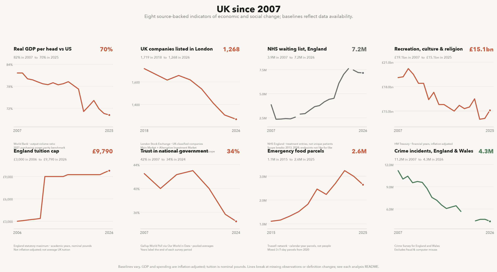

<div align="center">
  <h1>Social, Economic, and Political Change in the United Kingdom</h1>
  <p>
    <a href="#uk-since-2007">Overview</a> ·
    <a href="#explore-the-evidence">Analyses</a> ·
    <a href="#setup">Setup</a> ·
    <a href="https://www.themarginoferror.com/uk_decline/">Live site</a>
  </p>
</div>

---

## UK since 2007

The overview combines eight source-backed indicators, including official statistics,
charity administrative counts and a constructed tuition-fee series. It uses 2007 as
the common framing; each panel uses its own available baseline and latest year.
It is not a composite index or an exhaustive measure of UK performance. Colours
describe the selected direction of change between endpoints, not the latest annual trend.
The overview uses **year-only labels**: financial and academic years use their
starting year; pooled trust surveys and CSEW periods use their ending year.
Monthly waiting-list and company counts use the latest available snapshot in
each year. These periods are not interchangeable annual observations.

<p align="center">
  
</p>

The GDP comparison uses **constant-price purchasing-power parity (PPP)**, not
market-exchange-rate dollars, so sterling movements are not mistaken for relative
changes in economic output. The tuition panel shows the **England undergraduate
fee cap in nominal pounds**, through **£9,790 for 2026/27**. It is not
inflation-adjusted or average UK tuition. The separate
[tuition analysis](tuition/README.md) retains the real-dollar history, which ends
earlier because it requires same-year annual exchange rates and US CPI.
The NHS waiting list counts **entries awaiting consultant-led treatment**, not
unique patients. It excludes non-consultant-led pathways and estimates for missing
providers; the latest snapshot is **August 2026**. Trussell figures count **parcels
distributed by its network**, not unique recipients or all UK food-bank provision.
The listed-company panel uses **LSE-classified UK companies on the Main Market
and AIM**, including investment companies: **1,719 in December 2018 to 1,268 in
July 2026**. It starts after the Main Market's May 2018 coverage change. This is
not the World Bank/WFE definition; the separate international charts retain WDI
counts, and the two sources are never spliced. See the
[stock-market analysis](markets_data/README.md) for the sources and exact dates.

The GDP ratio represents **real output volumes valued at the 2021 PPP benchmark**,
not median household income or annually repriced purchasing power. The
[GDP analysis](europe_data/README.md) separates national-accounts real
growth from nominal dollar valuations; the [PPP analysis](ppp_data/README.md) adds a
2007 = 100 growth chart and documents the methodological research and validation.

The crime panel shows **estimated incidents in England & Wales, excluding fraud and
computer misuse**, from ONS Crime Survey Table A1a: **11.2 million in the year ending
March 2007 to 4.3 million in the year ending March 2026**. Lower counts are shown as
an improvement. This is a long-run survey measure, not all UK crime, a police-recorded
total, or the percentage of people victimised; it does not cover every offence type.
See the [crime analysis](crime_data/README.md) for coverage and the separate series
including fraud and computer misuse.

## Explore the evidence

**Economy and living standards:** [GDP and incomes](europe_data/README.md),
[stock markets](markets_data/README.md), [sterling](sterling_data/README.md),
[trade](trade_data/README.md), [London's economy](london_data/README.md), and
[purchasing power parity](ppp_data/README.md).
[Government debt and borrowing costs](debt_data/README.md) distinguish the UK
public-debt stock relative to GDP from market yields on government bonds.

**Public services and infrastructure:** [austerity](austerity_data/README.md),
[NHS performance](nhs_data/README.md), and [rail performance](rail_data/README.md).

**Household pressure:** [tax](tax/README.md), [tuition](tuition/README.md), and
[food-bank use](foodbank_data/README.md).

**Population and institutions:** [migration](uk_migration/README.md),
[ageing](age_data/README.md), [crime](crime_data/README.md), and
[institutional trust](trust_data/README.md).

Each analysis is a self-contained pipeline with its own methodology, caveats, charts, and
primary-source citations. The complete figure collection is in [`outputs/`](outputs).

## Setup

```bash
python3 -m venv .venv
./.venv/bin/pip install -r requirements.txt
```

Each analysis runs as a module from the repo root, e.g.:

```bash
./.venv/bin/python -m europe_data.fetch_data      # fetch data -> data/
./.venv/bin/python -m europe_data.plot_uk_decline # figures -> outputs/gdp_income/
./.venv/bin/python -m markets_data                # UK vs US markets -> outputs/stock_markets/
./.venv/bin/python -m austerity_data              # austerity -> outputs/austerity/
./.venv/bin/python -m debt_data                   # debt/GDP and bond yields -> outputs/debt/
./.venv/bin/python -m foodbank_data               # food-bank use -> outputs/food_banks/
./.venv/bin/python -m sterling_data               # pound exchange rates -> outputs/sterling/
./.venv/bin/python -m trade_data                  # trade share of GDP -> outputs/trade/
./.venv/bin/python -m nhs_data                    # NHS -> outputs/nhs/
./.venv/bin/python -m rail_data                   # London rail delays -> outputs/rail/
./.venv/bin/python -m london_data                 # London's share of UK GDP -> outputs/london/
./.venv/bin/python -m crime_data                  # crime trend & homicide -> outputs/crime/
./.venv/bin/python -m ppp_data                    # PPP alternative view -> outputs/ppp/
```

See each analysis's README for its exact commands and full source citations.

### Website and automatic updates

The [public website](https://www.themarginoferror.com/uk_decline/) presents all 17 analyses,
with searchable topic navigation, full-resolution charts, downloads, and methodology.
It is built directly from tracked publication figures and documentation, not private
working files. It works without JavaScript; search, filters and the chart viewer are
progressive enhancements.

The Margin of Error builds these pages directly into its website, under `/uk_decline/`,
with charts embedded in the topic pages rather than an iframe or an external image
viewer. Its deployment checks for updated inputs twice daily, at **09:20 and 21:20 UTC**.
The former project-level GitHub Pages address redirects to the publication.

Every Monday at **06:37 UTC**, this repository's GitHub Actions workflow
refreshes the supported source pipelines, rerenders the figures
and overview, runs the tests, and publishes only if every stage succeeds. Failed source
requests, reported partial-source warnings, lost NHS series coverage, test failures or
broken local site links block publication; the previous successful site stays online.
The **Update site** workflow can also be run manually, with an optional data refresh.

Automatic refreshes do not discover or substitute new source definitions. LSE monthly
factsheet selection, national tuition schedules, publisher editions and historical
source URLs still require review. Charts retain their observation dates; rebuilding
the website does not make older data current. Method notes may quote results from
their documented source vintage.

```bash
./.venv/bin/python scripts/build_site.py     # offline build + link checks -> _site/
./.venv/bin/python -m http.server 8000 --directory _site
./.venv/bin/python scripts/refresh_data.py   # live refresh; may take some time
```

The small saved inputs required by `scorecard.py` are versioned so the overview can
also be rebuilt from a fresh checkout without fetching sources. Generated website
files stay out of Git. The publication installs `requirements-site.txt` and builds
the pages from this repository's saved inputs; it does not rerun the source fetches.

After generating the input CSVs, rebuild the overview image without re-fetching data:

```bash
./.venv/bin/python scorecard.py
```

## Data integrity
No API keys are required. Derived measures, source-published estimates, method breaks and coverage limitations 
are documented in each analysis. Downloaded/intermediate data generally lives under `data/`
(git-ignored, regenerable); cited historical input snapshots are tracked where needed.
The curated figures are under `outputs/` . Series reflecttheir available source vintages; 
revisions and missing observations can change future releases.
