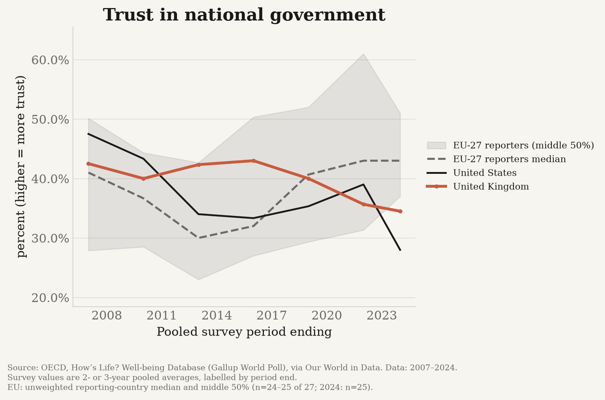
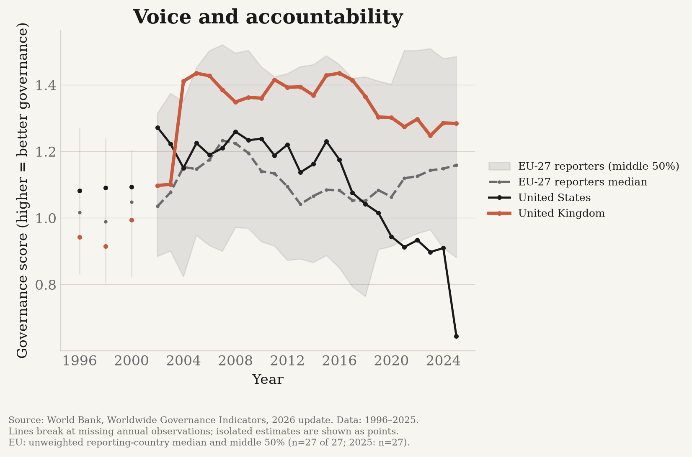
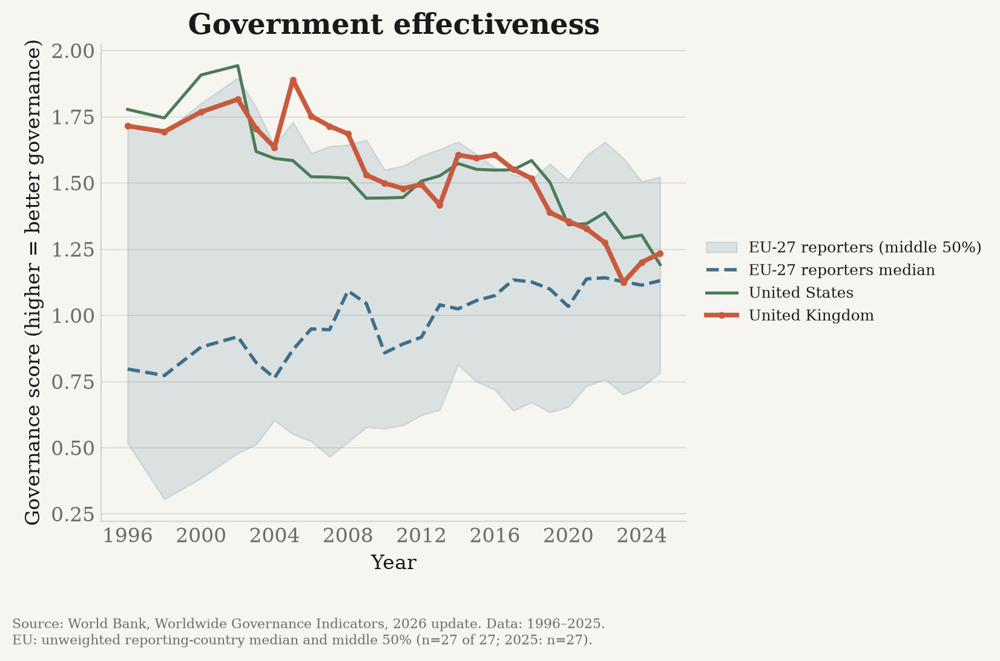
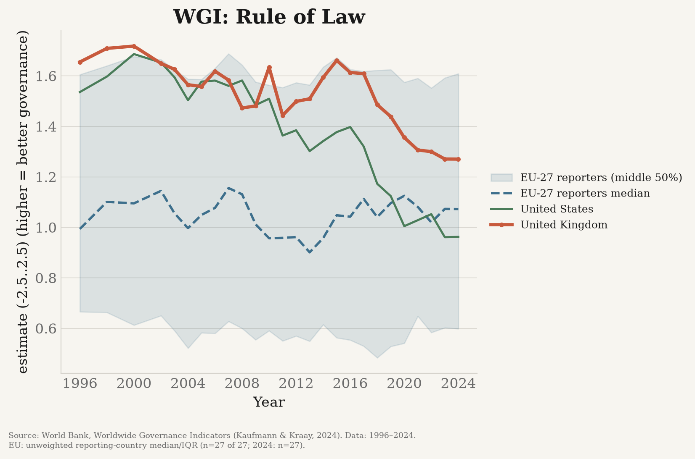
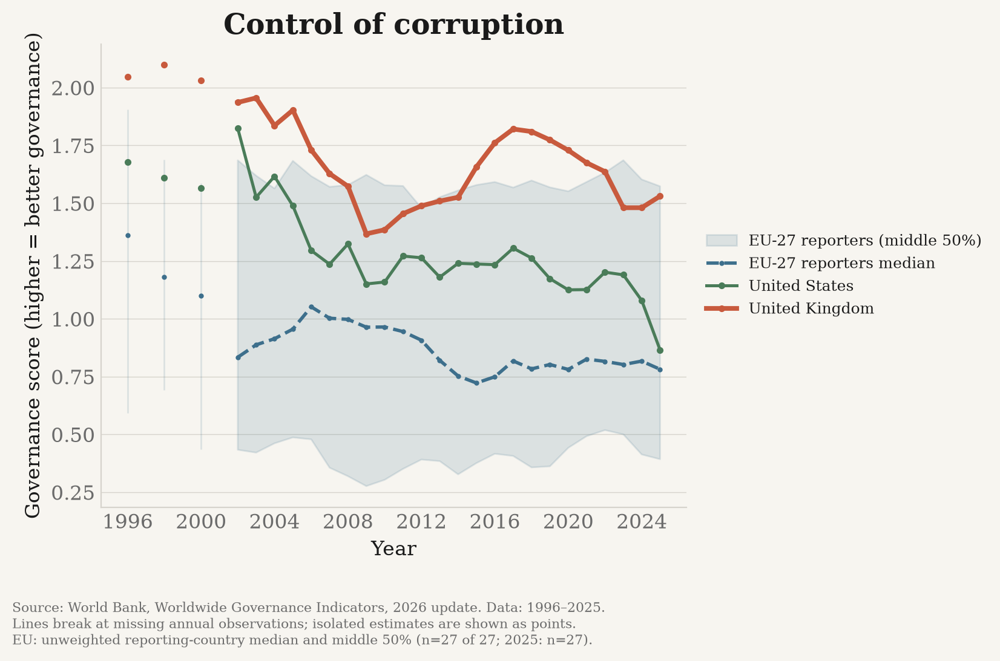

# Trust in UK government over time — data & figures

UK-first with EU-27 + US comparators. Generated by [`fetch_trust.py`](../../trust_data/fetch_trust.py); see [`trust_data/README.md`](../../trust_data/README.md) for full method notes.

**Coverage:** 1996–2025 · **3319 rows** · 29 countries.

## Data sources & citations

Every value is fetched from, or traceable to, the sources below — credited to the organisation that collected the data. Source observations are not fabricated by the tooling; WGI scores are source-published perceptions-based estimates, not objective measures of public trust. Each figure prints a source citation and the reporting-country coverage of any derived EU median/IQR.

- OECD (2026), with major processing by Our World in Data. “OECD average trust in governments” [dataset]. Original data: OECD, *How’s Life? Well-being Database* — survey item from the Gallup World Poll (“In this country, do you have confidence in national government, or not?”). https://ourworldindata.org/grapher/oecd-average-trust-in-governments
- World Bank (2026). “The Worldwide Governance Indicators: Methodology for Measuring Governance Using Perception Data.” Washington, DC: World Bank Group. Dataset: *Worldwide Governance Indicators (WGI)*, 2026 update, 1996–2025 (recalculated historical estimates), accessed 14 October 2026 via the World Bank API (DataBank source 3). https://www.worldbank.org/en/publication/worldwide-governance-indicators

## Figures

### Trust in national government

*Share of people who report they trust the national government (OECD, based on the Gallup World Poll question on confidence in national government). OWID/OECD observations are 2- or 3-year pooled averages, labelled by the final year of the period.*

- **Unit:** percent (higher = more trust) · **Coverage:** 2007–2024
- **Source:** OECD (2026), with major processing by Our World in Data. “OECD average trust in governments” [dataset]. Original data: OECD, *How’s Life? Well-being Database* — survey item from the Gallup World Poll (“In this country, do you have confidence in national government, or not?”). https://ourworldindata.org/grapher/oecd-average-trust-in-governments

### Voice and accountability

*Perceptions of the extent to which citizens can participate in selecting their government, plus freedom of expression, association and a free media (World Bank WGI, governance estimate).*

- **Unit:** estimate (-2.5..2.5) (higher = better governance) · **Coverage:** 1996–2025
- **Source:** World Bank (2026). “The Worldwide Governance Indicators: Methodology for Measuring Governance Using Perception Data.” Washington, DC: World Bank Group. Dataset: *Worldwide Governance Indicators (WGI)*, 2026 update, 1996–2025 (recalculated historical estimates), accessed 14 October 2026 via the World Bank API (DataBank source 3). https://www.worldbank.org/en/publication/worldwide-governance-indicators

### Government effectiveness

*Perceptions of the quality of public and civil services, policy formulation/implementation, and the credibility of the government's commitment to such policies (World Bank WGI).*

- **Unit:** estimate (-2.5..2.5) (higher = better governance) · **Coverage:** 1996–2025
- **Source:** World Bank (2026). “The Worldwide Governance Indicators: Methodology for Measuring Governance Using Perception Data.” Washington, DC: World Bank Group. Dataset: *Worldwide Governance Indicators (WGI)*, 2026 update, 1996–2025 (recalculated historical estimates), accessed 14 October 2026 via the World Bank API (DataBank source 3). https://www.worldbank.org/en/publication/worldwide-governance-indicators

### Rule of law

*Perceptions of confidence in and adherence to the rules of society - contract enforcement, property rights, the police and the courts (World Bank WGI).*

- **Unit:** estimate (-2.5..2.5) (higher = better governance) · **Coverage:** 1996–2025
- **Source:** World Bank (2026). “The Worldwide Governance Indicators: Methodology for Measuring Governance Using Perception Data.” Washington, DC: World Bank Group. Dataset: *Worldwide Governance Indicators (WGI)*, 2026 update, 1996–2025 (recalculated historical estimates), accessed 14 October 2026 via the World Bank API (DataBank source 3). https://www.worldbank.org/en/publication/worldwide-governance-indicators

### Control of corruption

*Perceptions of the extent to which public power is exercised for private gain, including petty and grand corruption and state capture (World Bank WGI).*

- **Unit:** estimate (-2.5..2.5) (higher = better governance) · **Coverage:** 1996–2025
- **Source:** World Bank (2026). “The Worldwide Governance Indicators: Methodology for Measuring Governance Using Perception Data.” Washington, DC: World Bank Group. Dataset: *Worldwide Governance Indicators (WGI)*, 2026 update, 1996–2025 (recalculated historical estimates), accessed 14 October 2026 via the World Bank API (DataBank source 3). https://www.worldbank.org/en/publication/worldwide-governance-indicators

## Generated files and retained snapshots

- `trust_combined_long.csv` / `trust_combined_wide.csv` — tidy data tables
- `manifest.json` — run metadata (row counts, year span, source list)
- `raw/manual_trust.csv` — historical OWID/OECD snapshot; not a production fallback
- `../../outputs/trust/trust_national_govt_pct.png` — Trust in national government
- `../../outputs/trust/wgi_control_of_corruption.png` — Control of corruption
- `../../outputs/trust/wgi_government_effectiveness.png` — Government effectiveness
- `../../outputs/trust/wgi_rule_of_law.png` — Rule of law
- `../../outputs/trust/wgi_voice_accountability.png` — Voice and accountability
- `processed/trust_summary.csv` — UK trend summary
