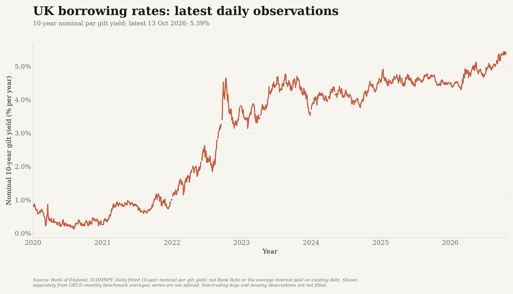
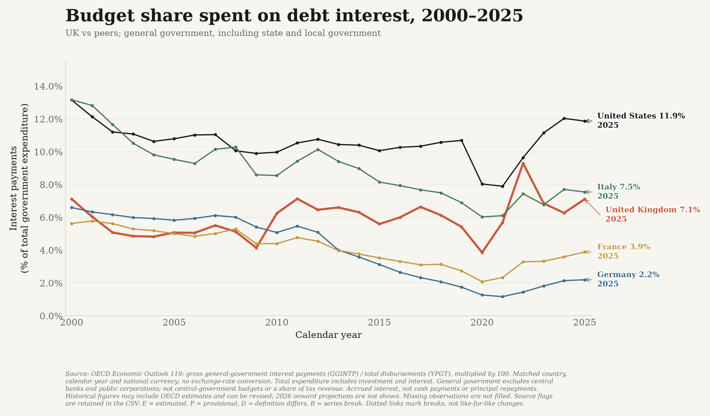

# Government debt and borrowing costs

Three distinct questions: **how large is the UK's public debt relative to its economy,
what market interest rates apply to new borrowing, and how much of government
spending is used for interest on existing debt?**

## Public debt relative to GDP


The Office for National Statistics' monthly **public-sector net debt excluding
public-sector banks** series (`HF6X`, dataset `PUSF`) is used without calculating
a replacement GDP denominator. It covers the public sector, including the Bank
of England, and subtracts liquid financial assets. It is **not general-government
gross debt**, which has a different institutional scope and asset treatment.

Each point is a monthly debt snapshot relative to the ONS GDP denominator, not
the amount borrowed during the month or a calendar-year average. GDP estimates and
debt classifications can revise the historical ratio. This is an official ratio:
the GDP denominator may include ONS estimates of quarters not yet observed.
No separate forecast series is appended.

The comparison begins in 2000. The debt ratio rose sharply around the financial
crisis and pandemic; subsequent movements reflect both changes in the debt stock
and changes in nominal GDP. A falling ratio need not mean the cash debt stock fell.

## Market borrowing rates



The Bank of England's **daily 10-year nominal par gilt yield** (`IUDMNPY`)
provides the recent UK view. It is a fitted yield-curve observation, shown from
2020 onward, not Bank Rate or the actual interest bill on existing debt.
The last observation's full date and value are printed above the plot.
Non-trading days and missing observations are not filled.

This daily series is shown separately from the international monthly comparison
below. The two sources differ in frequency and construction and are never spliced.


The OECD's **10-year government-bond benchmark yields**, published in its Main
Economic Indicators and reproduced by the Federal Reserve Bank of St. Louis,
provide comparable monthly long-term interest-rate observations for the UK,
United States, Germany, France and Italy. UK government bonds are called **gilts**.
These are nominal annualised yields, shown as monthly averages, not a Bank Rate
series, a daily market quote or an inflation-adjusted return.

The UK yield fell to very low levels during the pandemic before rising materially
from 2022. Higher yields raise the market cost of new borrowing and refinancing,
but **do not immediately reprice every outstanding bond**. Actual interest
expenditure also depends on maturities, earlier coupons, index-linked gilts,
inflation and the public sector's other liabilities.

The countries borrow in different currencies. Differences in expected inflation,
monetary policy, term premia and credit/liquidity risk all affect yields. Do not
interpret a UK-US or UK-Germany spread as a pure measure of fiscal credibility.
Nor should net debt multiplied by the 10-year yield be presented as the actual
interest bill: neither the debt base nor the interest rate matches that calculation.

## Share of the budget spent on interest



The UK, United States, Germany, France and Italy are compared using the latest
**OECD Economic Outlook** edition's **general-government** series. This includes central, state and local government
and social security funds, but excludes central banks and public corporations.
Comparing central-government budgets alone would give different institutional
coverage in federal and non-federal countries.

For each country and calendar year, the calculation is:

**100 x gross interest payments (GGINTP) / total disbursements (YPGT).**

Both amounts come from the same Economic Outlook edition, in the same national
currency and year. Unit multipliers are applied before division; no exchange-rate
conversion or GDP denominator is involved. The denominator is total disbursements,
including current spending, investment and interest. It is **not** just departmental
day-to-day spending, tax revenue or the UK's broader public-sector TME measure.

The comparison has complete annual coverage from **2000 through 2025 for all five
countries**, with **26 published annual values per country**.
Every endpoint is explicitly dated.
These are calendar-year national accounts, not UK April-March financial years or
US federal fiscal years. Missing observations are not filled, and projections for
**2026 onward** are excluded. Historical figures can include OECD estimates and
can be revised; these are not claimed to be final national-account outturns.
The initial edition is **Economic Outlook 119 (June 2026)**. The refresh resolves
the latest edition from OECD metadata instead of pinning that vintage forever.
The same edition is used for every country and year, rather than splicing a newer
US estimate onto the less timely annual national-accounts dataset.

Interest is recorded on an **accrual basis**, including relevant index-linked
interest, rather than as cash leaving the Treasury that year. Principal repayments
are not interest. This is interest payable before subtracting government interest
receipts, not a net-interest-to-revenue indicator. Source estimates can be revised.
Source flags are retained in the CSV, with endpoint flags explained in the footnote
rather than appended to country labels; breaks use dotted links between genuinely
adjacent observed years, not fabricated observations.

## Sources and reproducibility

- [ONS public-sector net debt, HF6X](https://www.ons.gov.uk/economy/governmentpublicsectorandtaxes/publicsectorfinance/timeseries/hf6x/pusf);
  downloadable monthly CSV. Latest edition fetched: **22 September 2026**.
- OECD (2026), *Main Economic Indicators*, monthly long-term interest rates,
  percent per year, not seasonally adjusted. Published by the
  [Federal Reserve Bank of St. Louis](https://fred.stlouisfed.org/):
  [UK](https://fred.stlouisfed.org/series/IRLTLT01GBM156N),
  [US](https://fred.stlouisfed.org/series/IRLTLT01USM156N),
  [Germany](https://fred.stlouisfed.org/series/IRLTLT01DEM156N),
  [France](https://fred.stlouisfed.org/series/IRLTLT01FRM156N),
  [Italy](https://fred.stlouisfed.org/series/IRLTLT01ITM156N).
  All sources accessed **14 October 2026**.
- [Bank of England daily 10-year nominal par gilt yield, IUDMNPY](https://www.bankofengland.co.uk/boeapps/database/index.asp?SeriesCodes=IUDMNPY&UsingCodes=Y).
  The [documented CSV download interface](https://www.bankofengland.co.uk/boeapps/database/help.asp)
  is requested from January 2000 through `now`, without a fixed end date.
  Downloads use `curl`, which is available on the GitHub-hosted Ubuntu runner.
- [OECD Economic Outlook, current edition metadata](https://sdmx.oecd.org/public/rest/v1/dataflow/OECD.ECO.MAD/DSD_EO@DF_EO/latest?references=none):
  annual `GGINTP` (gross general-government interest payments) and `YPGT` (total
  general-government disbursements), current-price national currency (`XDC`).
  The CSV records the edition, exact source queries, component series and UTC
  retrieval time. OECD leaves the US currency attribute blank; `XDC` for the
  United States identifies US dollars, with no conversion or currency substitution.

```bash
./.venv/bin/python -m debt_data
./.venv/bin/python -m debt_data --from-csv data/debt_borrowing_long.csv
```

The tracked [long-format CSV](../data/debt_borrowing_long.csv) contains date,
country, metric, value, unit, source and series identifier. Monthly dates are
labelled with the first day of the reference month; this does not turn a monthly
average or month-end debt snapshot into a daily observation.
The separate [daily UK CSV](../data/uk_gilt_yields_daily.csv) uses actual observation
dates and the same explicit source and unit fields. Both tables are saved for offline
reconstruction; `--daily-csv` can select an alternative daily input path.
The [annual interest-budget CSV](../data/debt_interest_budget.csv) stores every
percentage, its unrounded interest and expenditure amounts in national currency,
both series identifiers, source status, query URL and retrieval time.
`--interest-csv` selects an alternative annual input/output path.

The **Monday 06:37 UTC** full refresh includes this analysis, including the daily
UK source and the international annual interest comparison. All sources must be
downloaded and validated before outputs are replaced. Wrong series, wrong units,
duplicate observations, non-finite values, missing published 2000-2025 coverage,
or loss of any previously saved observation stop the refresh. A live daily-yield
response more than seven calendar days old also blocks publication; offline
rebuilds do not impose this freshness check. Missing source observations are never
interpolated, and chart lines do not bridge absent months or business days.
The annual comparison also requires both same-country/year components, matching
currencies and government definitions, a positive expenditure denominator and
complete previously published annual coverage. Forecast flags block inclusion.

All four figures are embedded in the public topic page. This documentation
and the underlying data remain on GitHub, not in a duplicated website methods section.
