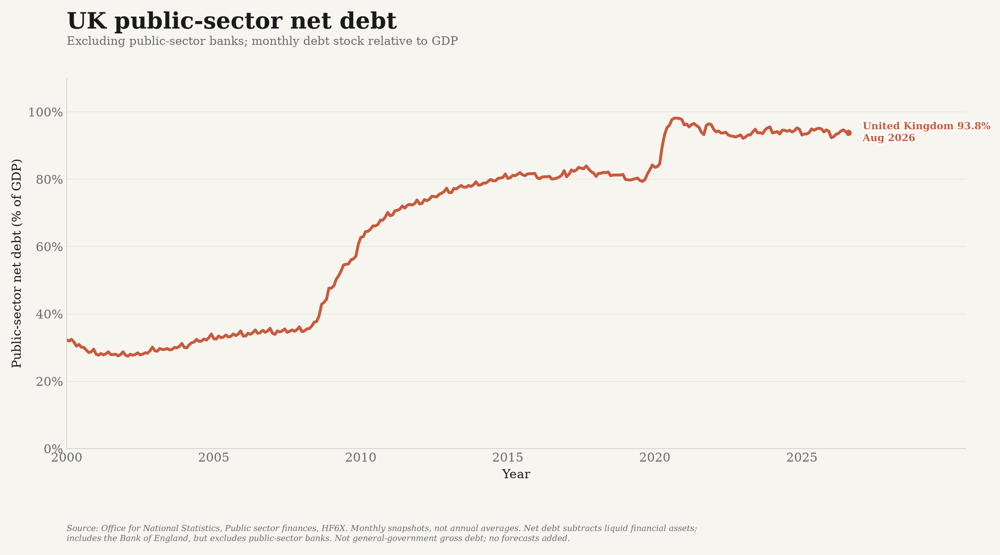
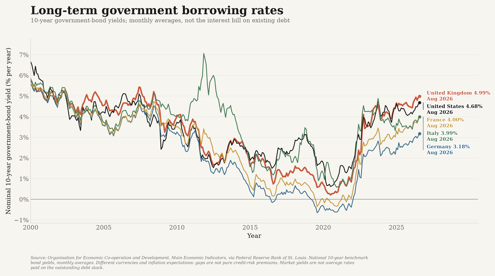

# Government debt and borrowing costs

Two distinct questions: **how large is the UK's public debt relative to its economy,
and what market interest rates apply to long-term government borrowing?**

## Public debt relative to GDP



The Office for National Statistics' monthly **public-sector net debt excluding
public-sector banks** series (`HF6X`, dataset `PUSF`) is used without calculating
a replacement GDP denominator. It covers the public sector, including the Bank
of England, and subtracts liquid financial assets. It is **not general-government
gross debt**, which has a different institutional scope and asset treatment.

Each point is a monthly debt snapshot relative to the ONS GDP denominator, not
the amount borrowed during the month or a calendar-year average. GDP estimates and
debt classifications can revise the historical ratio. This is an official ratio:
the GDP denominator may include ONS estimates of quarters not yet observed.
No separate forecast series is appended.

The comparison begins in 2000. The debt ratio rose sharply around the financial
crisis and pandemic; subsequent movements reflect both changes in the debt stock
and changes in nominal GDP. A falling ratio need not mean the cash debt stock fell.

## Market borrowing rates



The OECD's **10-year government-bond benchmark yields**, published in its Main
Economic Indicators and reproduced by the Federal Reserve Bank of St. Louis,
provide comparable monthly long-term interest-rate observations for the UK,
United States, Germany, France and Italy. UK government bonds are called **gilts**.
These are nominal annualised yields, shown as monthly averages, not a Bank Rate
series, a daily market quote or an inflation-adjusted return.

The UK yield fell to very low levels during the pandemic before rising materially
from 2022. Higher yields raise the market cost of new borrowing and refinancing,
but **do not immediately reprice every outstanding bond**. Actual interest
expenditure also depends on maturities, earlier coupons, index-linked gilts,
inflation and the public sector's other liabilities.

The countries borrow in different currencies. Differences in expected inflation,
monetary policy, term premia and credit/liquidity risk all affect yields. Do not
interpret a UK-US or UK-Germany spread as a pure measure of fiscal credibility.
Nor should net debt multiplied by the 10-year yield be presented as the actual
interest bill: neither the debt base nor the interest rate matches that calculation.

## Sources and reproducibility

- [ONS public-sector net debt, HF6X](https://www.ons.gov.uk/economy/governmentpublicsectorandtaxes/publicsectorfinance/timeseries/hf6x/pusf);
  downloadable monthly CSV. Latest edition fetched: **22 September 2026**.
- OECD (2026), *Main Economic Indicators*, monthly long-term interest rates,
  percent per year, not seasonally adjusted. Published by the
  [Federal Reserve Bank of St. Louis](https://fred.stlouisfed.org/):
  [UK](https://fred.stlouisfed.org/series/IRLTLT01GBM156N),
  [US](https://fred.stlouisfed.org/series/IRLTLT01USM156N),
  [Germany](https://fred.stlouisfed.org/series/IRLTLT01DEM156N),
  [France](https://fred.stlouisfed.org/series/IRLTLT01FRM156N),
  [Italy](https://fred.stlouisfed.org/series/IRLTLT01ITM156N).
  All sources accessed **14 October 2026**.

```bash
./.venv/bin/python -m debt_data
./.venv/bin/python -m debt_data --from-csv data/debt_borrowing_long.csv
```

The tracked [long-format CSV](../data/debt_borrowing_long.csv) contains date,
country, metric, value, unit, source and series identifier. Monthly dates are
labelled with the first day of the reference month; this does not turn a monthly
average or month-end debt snapshot into a daily observation.

The scheduled full refresh includes this analysis. All six source series must be
downloaded and validated before outputs are replaced. Wrong series, wrong units,
duplicate observations, non-finite values, missing published 2000-2025 coverage,
or loss of any previously saved month stop the refresh. Missing source observations
are never interpolated, and chart lines do not bridge absent months.

Only these two figures are embedded in the public topic page. This documentation
and the underlying data remain on GitHub, not in a duplicated website methods section.
