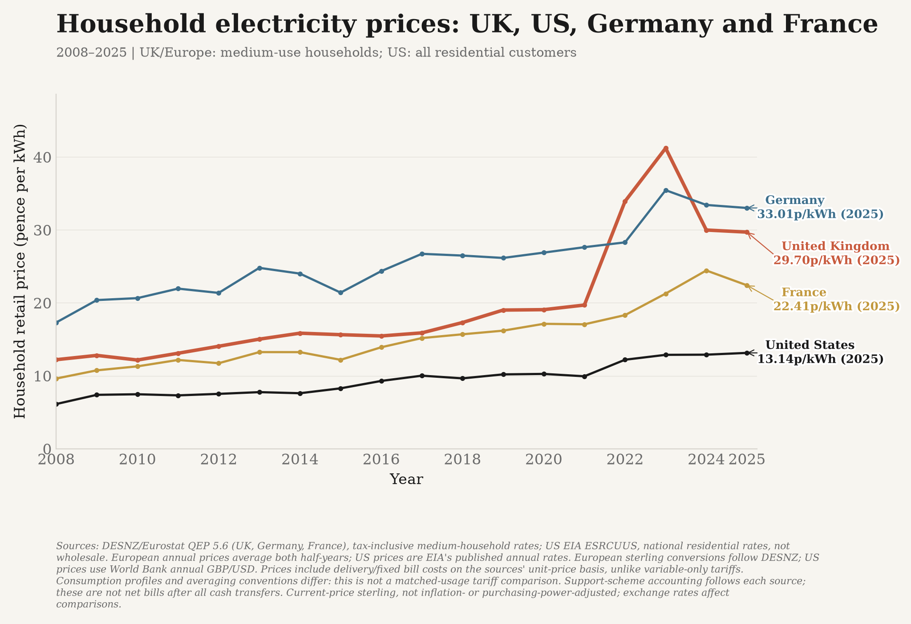
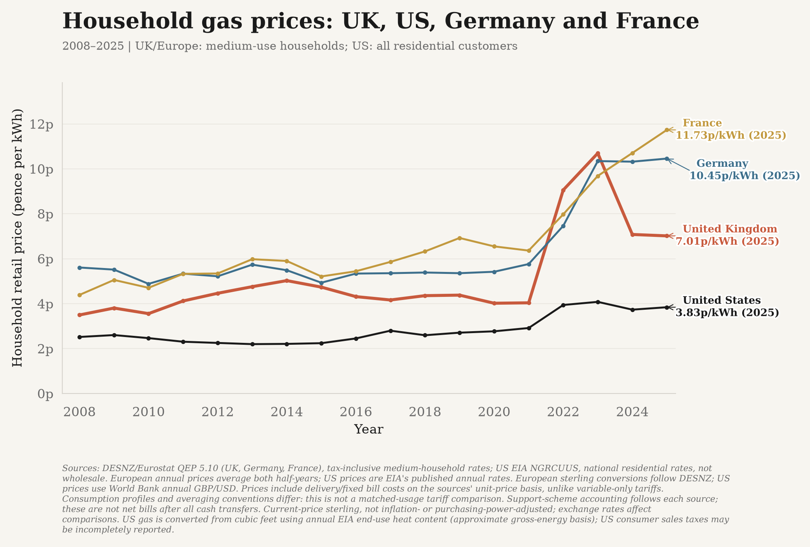
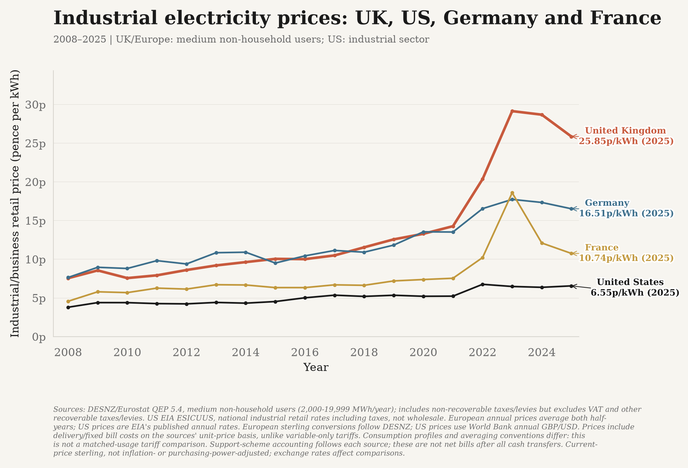

# Household energy costs





Annual **household retail electricity and gas prices** for the **UK, US, Germany and
France**, in **current pence per kilowatt-hour**. Each chart spans **2008–2025** with
18 published observations per country. Germany and France are European peers,
**not an EU aggregate**. These are not wholesale or industrial-energy prices.

## Sources and comparison limits

The UK, Germany and France use [DESNZ's international domestic energy workbooks](https://www.gov.uk/government/statistical-data-sets/international-domestic-energy-prices),
derived from Eurostat and UK Price Transparency data: **QEP 5.6** for electricity,
**QEP 5.10** for gas, **Annual incl tax**, **Medium** consumers. Prices include VAT,
levies, supply and network/fixed components on the sources' unit-price basis.
They are not the variable-only tariff rates in the separate domestic 2.2.4/2.3.4 tables.
Electricity covers **2,500–4,999 kWh/year**; gas **5,557–55,556 kWh/year**.
Annual prices are the published unweighted means of the two semesters. DESNZ's
sterling conversion follows exchange rates for each reporting period.

The US uses [EIA Monthly Energy Review](https://www.eia.gov/totalenergy/data/monthly/):
**ESRCUUS**, national residential electricity prices including taxes, from table 9.8;
**NGRCUUS**, delivered residential gas prices, from table 9.10. These cover **all
residential customers**, not the European medium-use bands. Annual records use EIA
period **13**, not an unweighted mean of monthly prices. EIA electricity prices
include generation, network/delivery costs, taxes and fees. Gas prices aim to cover
the full delivered cost, but [EIA cautions that consumer sales taxes may not be fully reported](https://www.eia.gov/state/seds/sep_prices/notes/pr_intro.pdf).

US cents/kWh are multiplied by annual **GBP per USD** from the World Bank
[`PA.NUS.FCRF`](https://api.worldbank.org/v2/country/GBR/indicator/PA.NUS.FCRF?format=json).
For US gas, dollars per thousand cubic feet are converted using **that year's**
EIA end-use heat content (`NGTXKUS`, Appendix A4, Btu/cubic foot):

```
kWh per thousand cubic feet = annual Btu per cubic foot * 1000 / 3412
pence per kWh = dollars per thousand cubic feet * GBP per USD * 100
               / kWh per thousand cubic feet
```

The **3412 Btu/kWh** conversion follows EIA Appendix A6. This is an approximate
gross-energy conversion using the published end-use heat-content factor, not a
claimed residential-only laboratory measurement. The CSV records every raw rate,
currency rate and heat-content factor needed to reproduce the US lines.

**Important:** consumption profiles, annual weighting, exchange-rate conventions,
support schemes and tax reporting differ. The graphs disclose the US/European
coverage difference in their subtitles. They are descriptive retail-price comparisons,
**not perfectly matched tariffs or fixed-consumption household bills**.
Support schemes follow the accounting in each source: the chart must not be read as
net household spending after all cash transfers, rebates or other government assistance.
Prices are nominal sterling at market exchange rates, not purchasing-power- or
inflation-adjusted. Exchange-rate movements can change the international comparisons.
No projected prices, price caps, wholesale benchmarks or carried-forward observations
are spliced into the lines.

## Industrial electricity



The third chart adds **industrial/business electricity**, with the same four countries,
**2008–2025** annual coverage and **pence/kWh** units. It is separate from household
prices and has its own saved dataset, `data/industrial_electricity_prices.csv`.

The UK, Germany and France use [DESNZ/Eurostat QEP 5.4](https://www.gov.uk/government/statistical-data-sets/international-non-domestic-energy-prices),
**Annual incl tax**, **Medium**: **2,000–19,999 MWh/year non-household users**.
These figures include non-recoverable taxes and levies but **exclude VAT and other
recoverable taxes and levies**. Non-household data cover businesses, not solely
manufacturing plants. The US uses EIA **ESICUUS**, national **industrial-sector**
retail electricity prices including taxes, converted from cents/kWh using the same
annual World Bank GBP/USD series. It does not use household or commercial-sector prices.

The different sector boundaries, consumption profiles and tax conventions are
disclosed in the subtitle/footnote: this is a descriptive comparison, not a perfectly
matched industrial contract or every factory's effective energy cost. US annual
rates, European two-semester averages and exchange-rate conventions follow the
same documented rules as the household comparisons. The current QEP 5.4 workbook
was published **28 May 2026**.

## Rebuild and refresh

```bash
MPLBACKEND=Agg .venv/bin/python -m energy_data
MPLBACKEND=Agg .venv/bin/python -m energy_data --from-csv data/household_energy_prices.csv \
  --industrial-from-csv data/industrial_electricity_prices.csv
```

The website and weekly source-refresh pipeline include all three charts. The household
CSV contains **144 country/fuel/year observations**, and the industrial CSV another
**72**, both supporting offline rebuilding.
GOV.UK workbook attachments are resolved on each refresh. Source dates distinguish
actual workbook publication dates from the retrieval date of EIA's undated CSV
snapshots; retrieval timestamps are not presented as publication dates.
Provisional/revised workbook flags remain in the CSV and are explained in the
figure footnotes, not appended as unexplained end-label letters.

Missing peers, unequal coverage, source-definition changes, wrong unit conversions,
missing FX/heat inputs and lost published observations fail validation. Only complete
calendar years are accepted; neither missing semesters nor source failures are filled.
