# europe_data — UK GDP per person: nominal, real, PPP and household income

Reproducible pipeline documenting the **UK's relative economic performance** vs. the US and
European peers, using public source observations and explicitly labelled derived measures.
Upstream national accounts and PPPs are estimates, and recent observations can be revised.

Three GDP questions are kept separate:

- **Real output growth:** World Bank `NY.GDP.PCAP.KD`, national-accounts volumes at
  constant 2015 US dollars with fixed-base conversion. Annual exchange-rate movements
  do not drive this series. Cross-country dollar levels are not PPP-adjusted.
- **Nominal dollar valuation:** `NY.GDP.PCAP.CD`, at current prices and each year's
  market exchange rate. It includes GDP prices and exchange-rate movements, not just growth.
- **PPP output comparisons:** the [PPP analysis](../ppp_data/README.md) distinguishes
  current-PPP levels from constant-2021-PPP volumes. The overview uses the latter.

The legacy `gdp_per_capita_real_usd` column remains available for compatibility:
nominal dollars divided by US CPI. **It is not national-accounts real GDP** and is no
longer the headline real-output chart. Its arithmetic is retained for tuition conversion.

## Headline results (figures in [`../outputs/`](../outputs))

### US, EU and Poland relative to the UK: separate measures

The public page uses the same single-panel layout for two comparisons:
**US, EU and Poland lines, with the UK fixed at 100**. Germany and France are not
separate lines in these public GDP comparisons. The EU is the published World Bank
aggregate, not an average reconstructed from selected countries.

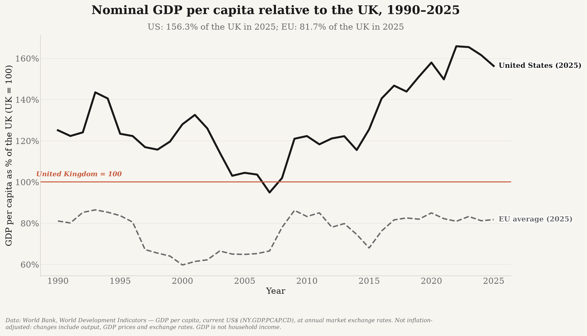
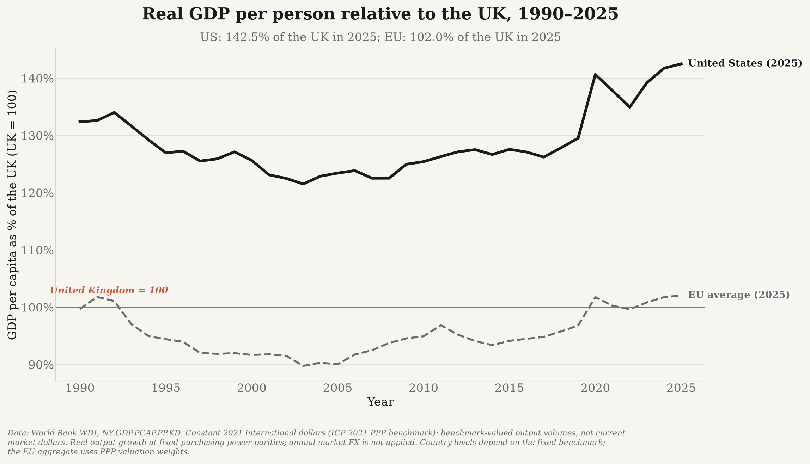

For the article's historical comparison, the second public chart uses **real
GDP at fixed 2021 PPPs**, not current-price PPPs. Its changes track benchmark-valued
output volumes rather than changes in each year's international price weights.
The benchmark remains explicit because cross-country level gaps depend on it.

The current-price PPP comparison and four-panel UK/US exchange-rate audit remain
supplemental exports, not additional GDP comparisons on the public page:

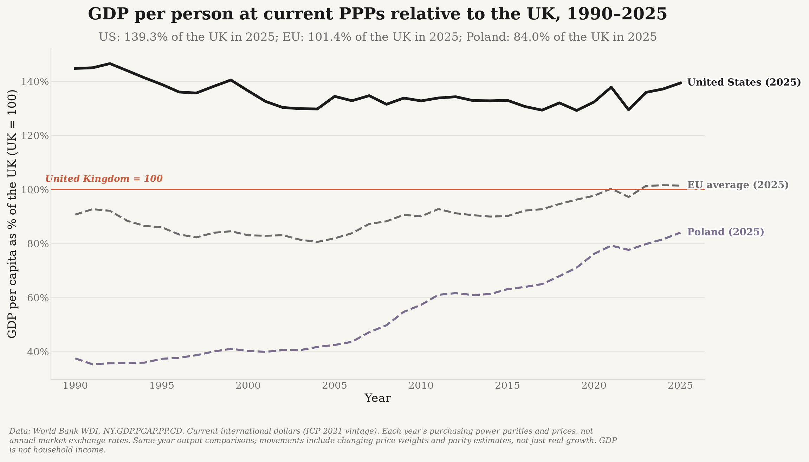

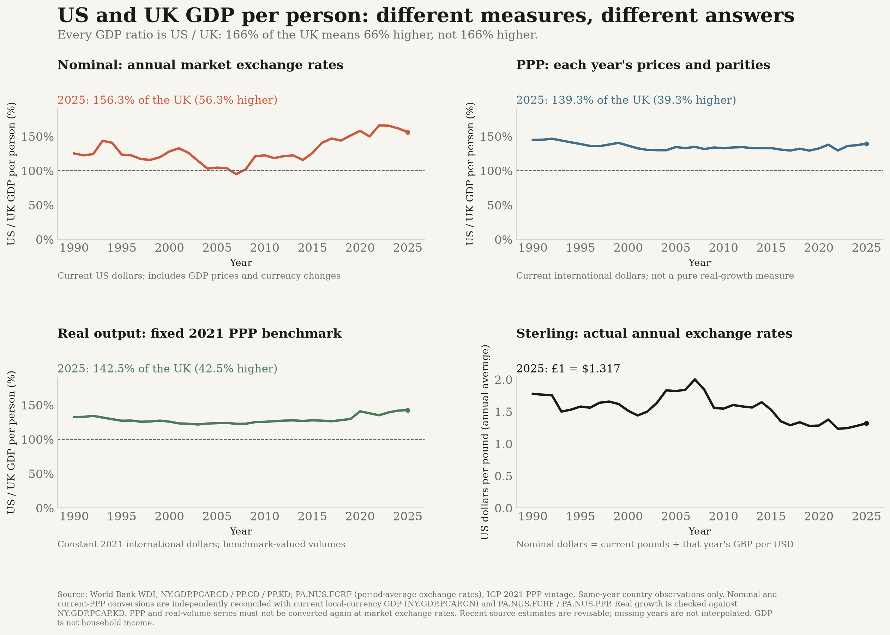

Every GDP panel uses **US / UK × 100**, not its reciprocal. A reading of 166%
means **66% higher**, not 166% higher. The World Bank's October 8, 2026 release,
re-fetched on October 15, gives:

| Year | UK nominal GDP/person, current US$ | US nominal GDP/person, current US$ | US as % of UK |
|---|---:|---:|---:|
| 2022 | $47,035 | $78,009 | 165.9% |
| 2023 | $49,920 | $82,587 | 165.4% |
| 2024 | $53,341 | $86,170 | 161.5% |
| 2025 | $57,602 | $90,027 | 156.3% |

The remembered **166%** is consistent with 2022, not the latest 2025 observation
in this release. Recent source estimates and historical observations can be revised.
For the same 2025 observations, the US is **139.3%** of the UK at current PPPs
and **142.5%** on the fixed-2021-PPP real-volume benchmark. These are different
valuation bases, not contradictory nominal estimates.

The fourth panel shows annual-average **US dollars per pound**, the reciprocal
of WDI `PA.NUS.FCRF` (GBP per USD). Nominal GDP uses **each observation year's**
conversion, not today's rate or one fixed conversion across history:

```
UK nominal GDP/person in USD = UK GDP/person in current GBP / annual GBP per USD
UK current-PPP GDP/person = UK GDP/person in current GBP / GBP per international dollar
```

The pipeline independently fetches current-local-currency GDP (`NY.GDP.PCAP.CN`),
annual market FX (`PA.NUS.FCRF`) and GDP PPPs (`PA.NUS.PPP`) for both countries,
and checks both equations against WDI's published converted GDP, by country and
year. Misalignment or a discrepancy exceeding 0.5% stops publication. No extra
market-FX conversion is applied to an already dollar-denominated GDP series, PPP
series or fixed-base volume measure. Their growth is also cross-checked:
constant-PPP and national-accounts volumes must have the same growth within 0.2%.

### Real GDP per person growth, 2007 = 100 (national-accounts volumes)
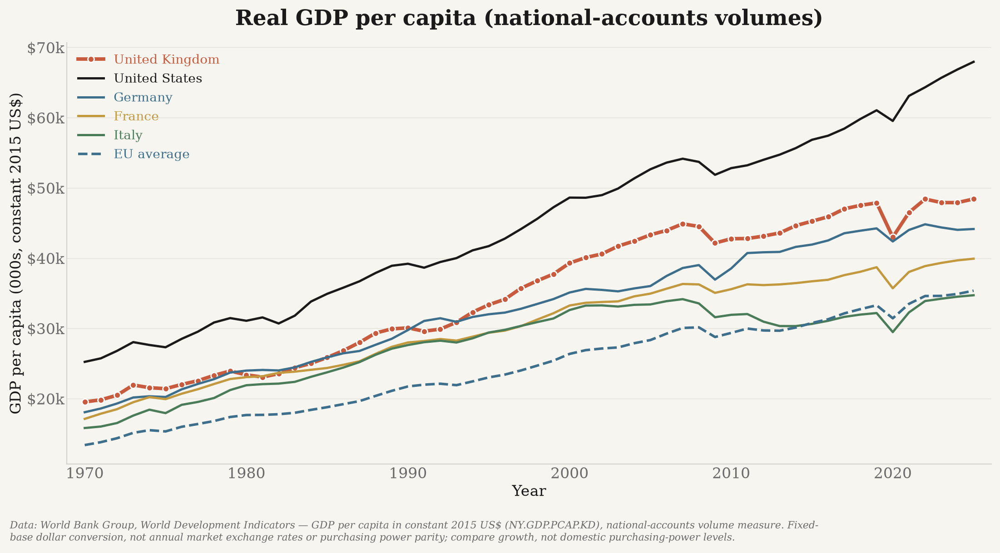

This supplemental chart indexes each economy to its own 2007 observation. This removes the
arbitrary fixed-base dollar-level gap and makes the real-growth question explicit:
**it is an index, not nominal dollars or a cross-country living-standard level**.

From 2007 to 2025, UK real output per head increased **7.9%**, against **25.5%** in
the US. This is slower growth, not an absolute loss of output over the entire interval.
The six individual countries' growth agrees with the constant-PPP volume series within
the validation tolerance; the EU aggregate is excluded because its valuation weights
differ. Fixed conversion factors change country-level units, not growth rates.

### Nominal GDP per capita, 1970–2025 (annual market FX)
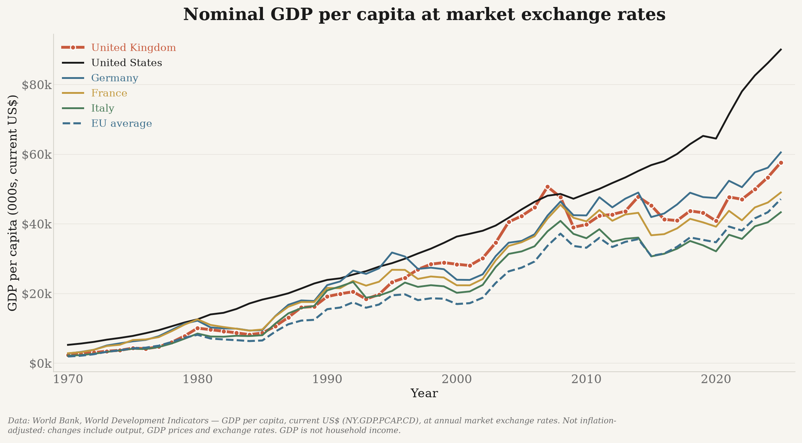

The UK was **105% of US dollar-valued GDP per head in 2007**, versus **64% in 2025**.
That much larger relative change includes GDP-price and exchange-rate effects.
These current-dollar levels are explicitly not inflation-adjusted.

### UK relative to its peers (US, Germany, France, EU average, Poland)
The public simplified version shows the US, EU aggregate and Poland:


The full comparison remains available:

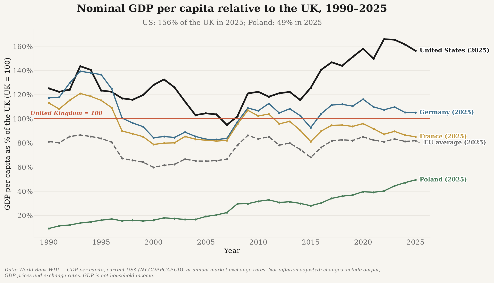

The linear percentage axis shows **peer / UK**, with the UK fixed at 100, not UK / peer.
In 2025 the US is **156%** of the UK and Poland **49%**, at market exchange rates.
Every ratio uses observations from the same year; endpoint labels state each peer's year.
These are dollar GDP valuations, not measures of household income or domestic purchasing
power. Deflating both countries by the same US CPI would leave each ratio unchanged.

The [PPP decomposition](../ppp_data/README.md) separates the nominal UK/US ratio change
into relative volume growth and a GDP-price/exchange-rate residual. Approximately 70%
of the 41-point change is attributed to non-volume factors by that accounting split;
it does **not** identify a causal currency effect or establish a loss of household welfare.

### Median disposable income (a "typical household" measure)
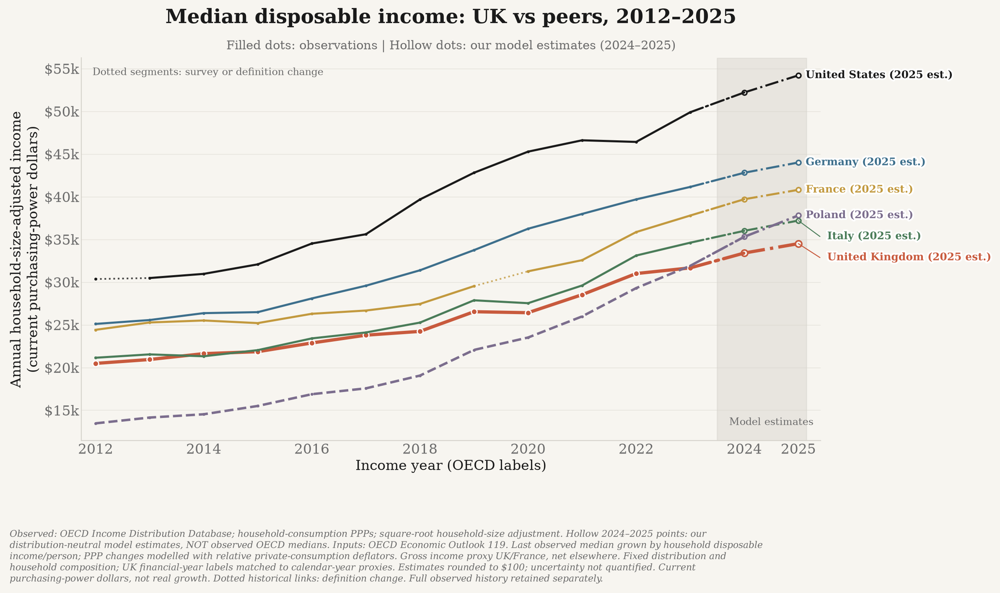

The public comparison uses the **OECD Income Distribution Database**, showing the
latest complete shared annual period for the UK, US, **Poland**, Germany, France
and Italy. The current window is **2012–2023**, with **12 published observations per
country**. This avoids isolated early points and uneven line starts masquerading
as a complete historical comparison.

The [full published history](../outputs/gdp_income/median_disposable_income_oecd_history.png)
is retained separately, together with its hover-data sidecar and the complete CSV.
The website links to this history from the GDP and incomes page. It preserves every
available observation, currently **2002–2023** overall: the UK starts in 2002,
Italy in 2003, Poland in 2005, Germany in 2008, France in 2011 and the US in 2012.
Earlier gaps are present in the OECD source, not removed by the fetcher.
Each country's latest observation remains in the history even if other countries
have not published that year. Unlike Eurostat, the UK continues after 2018.
Missing years are not filled; dotted links identify definition changes, not
like-for-like growth. Older methodology is not spliced in to manufacture annual values.

Income is disposable household income after taxes and transfers, divided by the
square root of household size. The national-currency medians are divided by
**same-country, same-year household-consumption purchasing power parities**, not
GDP PPPs or market exchange rates. The result is current-price purchasing-power
dollars: useful for same-year comparisons, **not inflation-adjusted income growth**.
OECD income-year labels are retained, including UK financial years.

The 2012 income methodology is selected throughout. Current definitions take
priority in overlapping years; earlier definitions are used only before the current
definition begins, never to fill subsequent holes. France's definition transition
in 2020 is retained as a line break, not smoothed away. Countries' national survey
methods still differ. Source status, definition, national-currency income, currency
and conversion factor are saved with each observation. Missing conversions,
mismatched currencies, duplicate observations, or lost published 2013–2023 coverage
stop the refresh instead of silently creating a fragmented comparison.

### Newer national and European observations

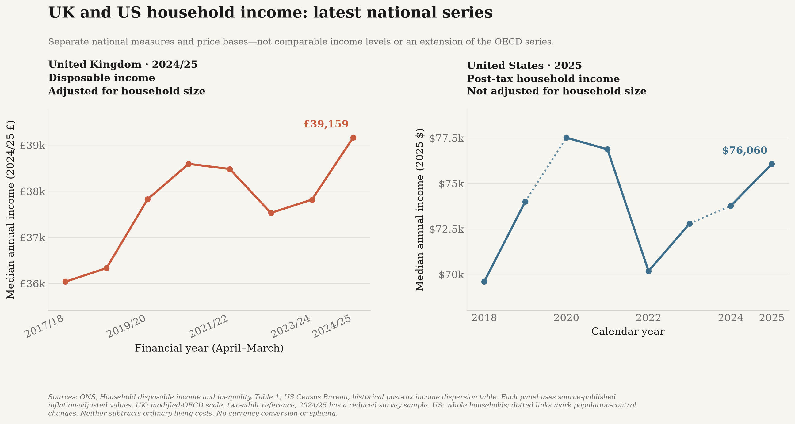
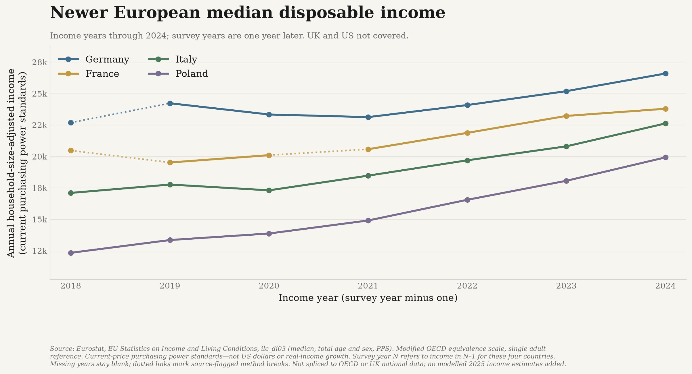

The OECD comparison currently ends in income year 2023. These separate figures
retain newer source-published observations without splicing incompatible definitions.
The UK panel uses the ONS Household Finances Survey, Table 1: median disposable
income under the modified-OECD equivalence scale, normalised to a two-adult household,
in source-published constant-price pounds. It reaches **April 2024–March 2025**.
The 2024/25 estimate has a reduced survey sample and increased uncertainty.
The US panel uses Census's historical **post-tax whole-household median**,
in source-published constant-price dollars, through **calendar-year 2025**.
It is not adjusted for household size. Population-control changes are shown with
dotted links. The two panels have different definitions, currencies and price bases:
their levels must not be compared directly.

The European figure uses Eurostat `ilc_di03` for Germany, France, Italy and Poland,
with the modified-OECD scale normalised to a single adult and current purchasing
power standards (not US dollars or constant-price growth). **Survey year 2025
measures income in 2024** for these countries. The x-axis explicitly uses income
years. This is not a newer UK/US comparison and cannot establish a newer UK–Poland
ranking. Modelled flash estimates of 2025 income are not added to observed series.

Sources:
- [ONS household disposable income workbooks](https://www.ons.gov.uk/peoplepopulationandcommunity/personalandhouseholdfinances/incomeandwealth/datasets/householddisposableincomeandinequality),
  latest dated edition, Table 1.
- [US Census national income tables](https://www.census.gov/topics/income-poverty/income/data/tables.html),
  latest edition, *Selected Measures of Household Post-Tax Income Dispersion*.
- [Eurostat mean and median income by age and sex](https://ec.europa.eu/eurostat/databrowser/view/ilc_di03/default/table),
  median, all ages and sexes, purchasing power standards.

The saved [recent-income source table](../data/recent_disposable_income.csv) retains
periods, survey years, price bases, definitions, source flags and download URLs.
The weekly GDP/income refresh discovers the latest dated ONS and Census workbooks,
fetches Eurostat, validates all six country series and preserves previously published
date coverage before replacing saved inputs.

```bash
./.venv/bin/python -m europe_data.recent_income
./.venv/bin/python -m europe_data.recent_income --from-csv data/recent_disposable_income.csv
```

The older Eurostat and World Bank comparisons remain supplemental, with coverage-aware
recent views rather than long stretches before most peers have observations:

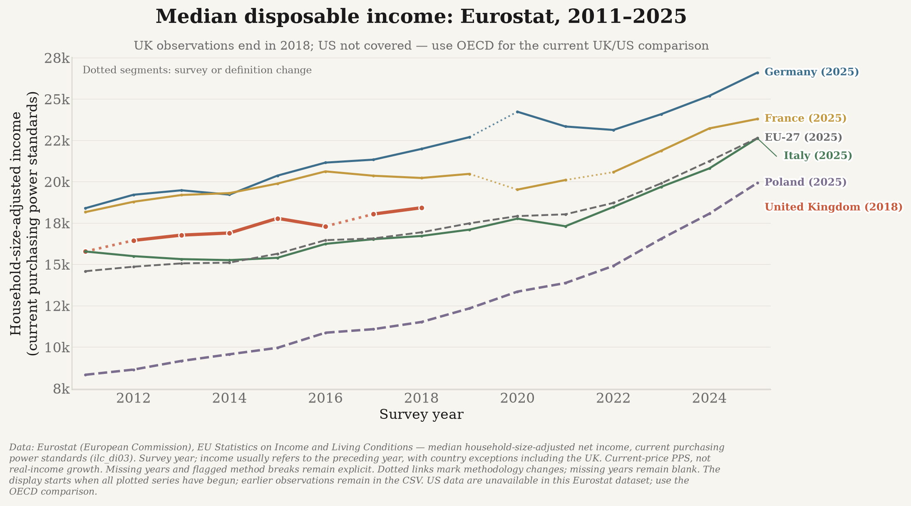
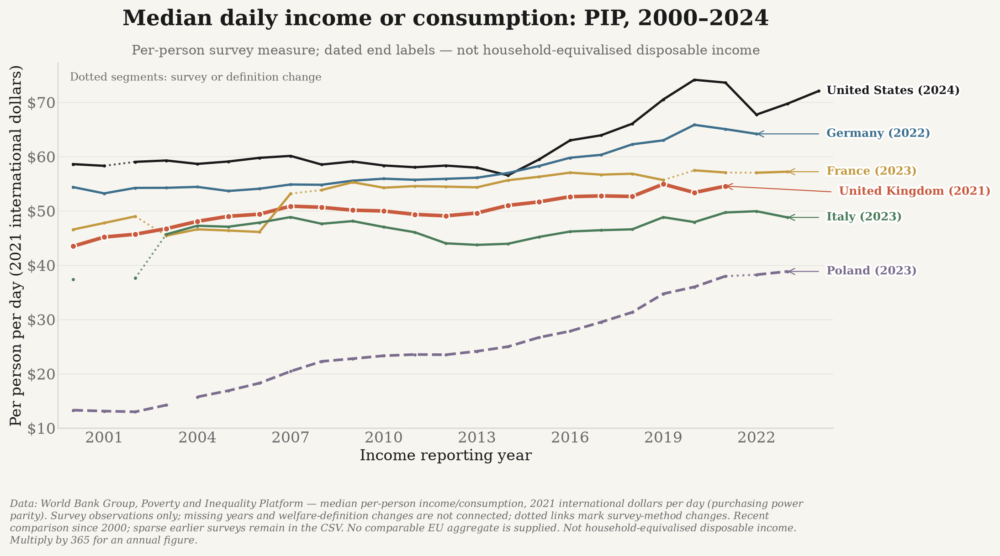

*Sources: Eurostat `ilc_di03` (ECHP/EU-SILC, median equivalised net income, current PPS;
UK ends 2018);
World Bank Poverty & Inequality Platform (median per-capita income/consumption,
2021 PPP $/day; UK to ~2021). These welfare definitions and equivalisation conventions
are different; they are not interchangeable household-income measures.*

Eurostat observations are labelled by **survey year**. Income usually refers to the
preceding calendar year, with exceptions including the UK. The ECHP-to-EU-SILC
transition and later national survey changes introduce method breaks. Source status
flags are retained in the data; dotted links identify adjacent observations across
method changes, while genuinely missing years stay unconnected. PIP's sparse early surveys are retained as points, not an
interpolated annual history in the saved data. Its comparability-spell identifiers and welfare types
are retained. Dotted links identify known comparability changes; welfare-type changes
remain unconnected. PPP adjustment does
not eliminate differences in national survey methods or welfare definitions.
PIP labels observations by the **welfare reporting year**, which can precede the
survey year when income is collected retrospectively.

The Eurostat chart starts at the **latest first-observation year among its required
comparators**, currently **2011**, and retains all subsequent supplied observations
through 2025. This avoids mixing the sparse ECHP-era histories into the recent
EU-SILC view. **UK observations still end in 2018**: the subtitle and dated end label
state this prominently; no replacement UK values or US series are fabricated.
The PIP chart shows **2000 onward**, not a 1970 start that leaves most early peer
histories blank. Every country keeps its own latest observation and genuine gaps.
End labels name each country and its year rather than implying a common current
endpoint. Both charts' **full earlier source histories remain in the CSV**; the
OECD full-history figure still preserves its complete available history.

Refreshes reject loss of previously published country/year/metric observations,
duplicate cells and non-finite values before replacing any source tables. Partial
`--sources` downloads must use a separate `--out` directory if a combined dataset
already exists, so a one-source download cannot silently erase the other measures.

Poland is included in all three income exports, with a consistent dashed purple line.
The supplemental PIP chart now also includes genuine US survey observations.
Eurostat's income dataset does not publish a US series, so that export does not invent
one; the OECD and PIP figures provide the US comparison. The OECD chart uses
household-consumption PPPs, not GDP PPPs or market exchange rates.

## Data sources (all free, no API key)

| Metric (column) | Source & citation | Endpoint | Inflation basis |
|---|---|---|---|
| `gdp_per_capita_real_usd` | **World Bank WDI** `NY.GDP.PCAP.CD` deflated by US CPI `FP.CPI.TOTL` (legacy) | `api.worldbank.org/v2/country/{iso3}/indicator/{id}` | US-CPI-adjusted dollar valuation, **not real output** |
| `gdp_per_capita_constant_usd` | **World Bank WDI** `NY.GDP.PCAP.KD` (real-output chart) | (same) | **Real** — constant 2015 US$ using fixed-base conversion |
| `gdp_per_capita_nominal_usd` | **World Bank WDI** `NY.GDP.PCAP.CD` (nominal chart and peer ratios) | (same) | Current prices and annual market FX |
| `gdp_per_capita_real_maddison` | **Maddison Project Database 2023** (Bolt & van Zanden), via Our World in Data | `ourworldindata.org/grapher/gdp-per-capita-maddison.csv?csvType=full` | Real — constant 2011 international $ (**PPP**); reference only |
| `gdp_per_capita_ppp_current` | **World Bank WDI** `NY.GDP.PCAP.PP.CD` | (same) | Nominal — current international $ (PPP); reference only |
| `gdp_per_capita_ppp_constant` | **World Bank WDI** `NY.GDP.PCAP.PP.KD` | (same) | Real — constant 2021 international $; overview and PPP growth charts |
| `gdp_per_capita_current_lcu` | **World Bank WDI** `NY.GDP.PCAP.CN`, UK and US | (same) | Current local-currency GDP, independent conversion check |
| `market_exchange_rate` | **World Bank WDI** `PA.NUS.FCRF`, UK and US | (same) | Annual-average local currency per US$; not a spot or year-end rate |
| `ppp_conversion_factor` | **World Bank WDI** `PA.NUS.PPP`, UK and US | (same) | Local currency per current international dollar; not market FX |
| `median_disposable_income` / `mean_disposable_income` | **Eurostat** `ilc_di03` (`MED_EI`/`MEAN_EI`, `unit=PPS`) | `ec.europa.eu/eurostat/api/dissemination/…/ilc_di03` | Current PPS (cross-country comparable; **not** deflated over time) |
| `median_disposable_income_oecd_ppp` | **OECD** Income Distribution Database; annual household-consumption PPPs | `sdmx.oecd.org/public/rest/v1/data/` flows `OECD.WISE.INE,DSD_WISE_IDD@DF_IDD,1.0` and `OECD.SDD.NAD,DSD_NAMAIN10@DF_TABLE4,1.0` | Current household-consumption purchasing-power US dollars; **not real growth** |
| `median_income_pip` | **World Bank PIP** (Poverty & Inequality Platform), pinned `ppp_version=2021` | `api.worldbank.org/pip/v1/pip` | **Real** — constant 2021 PPP $ per day |


**Why publish multiple bases?** No single GDP series answers every question. National
accounts volumes measure growth; annual market dollars measure dollar valuations;
PPP conversion supports output-volume comparisons across economies. GDP per capita is
not median household income, and GDP PPPs are not household consumption PPPs.

**Countries plotted:** United Kingdom (focus), **United States**, **Poland**, Germany,
France and Italy (US income availability differs by source as noted above).
GDP charts also include the World Bank EU aggregate; the nominal peer-ratio chart includes
Poland. Spain is fetched but not plotted.

## Citations

GDP inputs: WDI release updated **8 October 2026**, re-fetched and independently
checked against annual FX and PPP conversion inputs **15 October 2026**.
Eurostat and PIP income data: accessed **13 October 2026**; US PIP and Poland OECD
additions checked **15 October 2026**. Maddison source:
accessed **15 August 2026**. OECD income and consumption PPPs: accessed **14 October 2026**.

- **OECD** (2026). [Income Distribution Database](https://www.oecd.org/en/data/datasets/income-and-wealth-distribution-database.html):
  `INC_DISP`, `MEDIAN`, `XDC_HH_EQ`, all ages, `METH2012`.
  [Annual purchasing power parities](https://www.oecd.org/en/data/indicators/purchasing-power-parities-ppp.html):
  `PPP_P31S14`, national currency per US dollar.
  The household-size adjustment and use of private-consumption PPPs follow
  [Society at a Glance 2024, household income](https://www.oecd.org/content/dam/oecd/en/publications/reports/2024/06/society-at-a-glance-2024_08001b73/918d8db3-en.pdf).

- **World Bank** (2026). *World Development Indicators* — GDP per capita, constant 2015 US$
  (`NY.GDP.PCAP.KD`); GDP per capita, current US$ (`NY.GDP.PCAP.CD`); GDP per capita, PPP
  (`NY.GDP.PCAP.PP.CD`/`.KD`). Washington, DC: World Bank Group. Derived from World Bank
  national-accounts data and OECD National Accounts data files.
  <https://data.worldbank.org/indicator/NY.GDP.PCAP.KD>
- **World Bank** (2026). *Poverty and Inequality Platform (PIP)* — median income/consumption
  per capita (2021 PPP). Washington, DC: World Bank Group. Compiled from national household
  surveys. <https://pip.worldbank.org>
- **Eurostat (European Commission)** (2026). *Mean and median income by age and sex*
  (`ilc_di03`), ECHP and EU Statistics on Income and Living Conditions (EU-SILC).
  Luxembourg: Eurostat.
  <https://ec.europa.eu/eurostat/databrowser/product/view/ilc_di03>
  [Definitions, reference periods and comparability](https://ec.europa.eu/eurostat/cache/metadata/en/ilc_sieusilc.htm).
- **Maddison Project Database:** Bolt, Jutta and Jan Luiten van Zanden (2024). "Maddison-style
  estimates of the evolution of the world economy: A new 2023 update." *Journal of Economic
  Surveys.* Maddison Project Database, version 2023. Groningen Growth and Development Centre,
  University of Groningen. Retrieved via Our World in Data.
  <https://www.rug.nl/ggdc/historicaldevelopment/maddison/>

## Setup & usage

```bash
python3 -m venv .venv && ./.venv/bin/pip install -r ../requirements.txt

# Fetch all sources (default 1970..current) into ../data/ :
./.venv/bin/python -m europe_data.fetch_data --start 1970 --end 2025

# Render the figures into ../outputs/ :
./.venv/bin/python -m europe_data.plot_uk_decline
```

Outputs: per-source CSVs, `europe_combined_long.csv`, `europe_combined_wide.csv`, and
`manifest.json` in `../data/`; ten PNGs in `../outputs/gdp_income/`.
The derived OECD source table (`oecd_median_income_ppp.csv`) and combined wide table
are tracked for reproducible offline chart generation; other raw downloads are git-ignored.

## Source observations and derived measures
PIP is fetched with `fill_gaps=false` (survey observations only); no
pipeline performs interpolation or gap-filling. That does not mean upstream GDP or PPP
estimates are free of modelling or extrapolation. Eurostat's `status` codes accompany
the long-format observations and appear as `<metric>__status` columns in the wide table
when flags are present; `b` identifies a break in series.
PIP's `survey_comparability` (including the valid identifier `0`) and `welfare_type`
are retained in long format and as `<metric>__survey_comparability` /
`<metric>__welfare_type` in wide format. A change between known identifiers or
welfare types marks a line break; absent metadata alone is not treated as a break.
This follows the World Bank's
[PIP comparability guidance](https://worldbank.github.io/PIP-Methodology-2022-04/welfareaggregate.html#comparability)
and the comparability metadata described in its
[March 2026 technical note, section 6](https://documents1.worldbank.org/curated/en/099434403202630952/pdf/IDU-6226a428-a460-457e-ad48-9625630a029f.pdf).
If any requested source returns no observations, the fetch run stops before replacing
the source files or combined tables.

The [PPP methodology](../ppp_data/README.md#methodology-and-contemporary-research)
compares the approach with World Bank guidance, the Eurostat-OECD PPP manual, and ONS's
August 2026 national-accounts analysis.

## Modules
`countries.py` (curated countries + US peer + aggregates) · `worldbank.py` · `maddison.py` ·
`eurostat.py` · `pip.py` · `oecd_income.py` · `combine.py` · `_http.py`. Entry points: `-m europe_data.fetch_data`,
`-m europe_data.plot_uk_decline`. Tests: `../tests/test_pipeline.py`.
