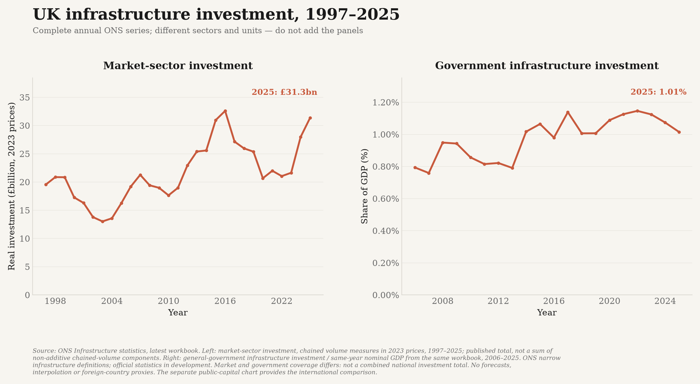

# Infrastructure investment, research funding and defence

Five separate investment/funding charts. International comparisons use
**percentages of GDP**; the ONS infrastructure chart separates real market-sector
investment in pounds from government investment relative to GDP.
They measure different things and must not be added together. In particular, military
R&D is included in military expenditure, government research budgets can finance R&D
performed in other sectors, and public fixed investment includes some capitalised R&D.

The UK, US and official EU aggregates are compared over **complete shared annual
periods**, with at least ten years of observations for every displayed line.
Poland is included in **military spending**, but not the infrastructure or research
comparisons. It remains in the separate GDP/income and purchasing-power analyses.
Later observations outside the common period remain in the source CSV.

Consecutive observed years are connected normally. Dotted links mark
source-flagged methodology changes between adjacent observed years, **not
like-for-like changes**; they add no inferred observations or hover values.
Genuinely missing years are not filled or joined.

## UK infrastructure investment



**ONS Infrastructure statistics**, latest workbook discovered from its dataset
page, initially the July 2026 edition. Both panels have complete annual data:

- **Market sector, 1997-2025:** published total investment in infrastructure,
  chained volume measures at **2023 prices**, shown in billions of pounds.
  The parser identifies the price benchmark in the workbook rather than hard-coding
  the reference year. It never sums non-additive chained-volume industry components.
- **General government, 2006-2025:** current-price infrastructure investment divided
  by the **same workbook's same-year current-price GDP**, shown as a percentage.
  Full numerator and denominator values are retained and reconcile with ONS's
  rounded published GDP shares.

Market-sector and government coverage/definitions differ; **do not add the panels**.
These are official statistics in development using ONS's narrow functional
infrastructure definition, not every capital asset. No US or EU series is spliced
onto the UK source. The separate public-capital chart provides the cross-country view.

The obsolete ITF transport chart was **retired**, not interpolated or silently
extended beyond its UK 2019 endpoint. All 63 original ITF source observations are
preserved in `data/archive/inland_transport_investment_2026-10-15.csv`; they are
not inputs to the new ONS figure. The active ONS input is
`data/uk_infrastructure_investment.csv`.

## Public capital investment


**OECD National Accounts**:

- Numerator: `DSD_NASEC10@DF_TABLE12`, `S13`, `P51G`, debit, current prices.
- Denominator: `DSD_NAMAIN10@DF_TABLE1_EXPENDITURE`, `S1`, `B1GQ`, current prices.
- Calculation: **100 x general-government gross fixed capital formation /
  same-country, same-calendar-year nominal GDP**.

Both inputs are converted from their reported unit multipliers to full units and
must use the same currency (GBP, USD, PLN or EUR). There is **no exchange-rate
conversion**. The saved data preserve the numerator, denominator, currency, exact
series identifiers and URLs, so every plotted ratio can be reconstructed.

This is **gross**, before depreciation. It includes government buildings, equipment,
weapons systems and capitalised research, not just infrastructure. It excludes
public corporations outside general government and is not the UK public-sector
**net** investment series in the separate austerity chart. The EU line uses the
published fixed-composition EU-27 aggregate, not an unweighted average.

## Government research funding


**Government budget allocations for R&D (GBARD)**, including civil and defence
objectives and general university funds. These are budget allocations, **not**
actual research spending, all government support, or only research performed in
government laboratories. R&D tax relief is excluded.

For UK and US, the source is **OECD Research and Development Statistics**,
`DSD_RDS_GOV@DF_GBARD_NABS07`, measure `C`, total socio-economic objective and funding
mode, current national currency. The ratio uses the same year's nominal OECD GDP,
with the same currency and unit-multiplier checks as public investment.

**Fiscal periods differ:** the numerator follows each source's annual budget-year
convention; GDP is calendar-year GDP for that published year. The chart therefore
compares annual budget effort, not precisely matched fiscal-year flows. The
**US series is federal budget authority**, not every state/local research budget.
These differences remain caveats rather than being silently relabelled.

The **EU-27** line is Eurostat's directly published GDP share from
`gba_nabsfin07`, `nabs07=TOTAL`, `unit=PC_GDP`, `geo=EU27_2020`. This is the
aggregate of member-government budgets, **not the EU institutions' own budget**.
The EU OECD current-PPP budget total is deliberately not divided by an unrelated
euro GDP series. Both providers use the Frascati GBARD framework.

The plotted **2004-2023** window is the complete common UK/US/EU-27 history.
It has no missing annual observations and all end labels refer to **2023**, not a
mixture of latest years. The only interior source-marked transition is shown as
a dotted link. Later US/EU observations, and Polish source data, remain in the CSV
but are not plotted. Preliminary/estimated allocations retain their flags.

## Total research and development spending


**OECD Main Science and Technology Indicators**, `DSD_MSTI@DF_MSTI`, measure `G`
(gross domestic expenditure on R&D, GERD), unit `PT_B1GQ`. Use the source's published
GDP shares, without a second conversion or a separately sourced denominator.

Includes R&D performed domestically by businesses, universities, government and
non-profits, regardless of funding origin. Includes foreign funding of domestic
research; excludes domestic money funding research abroad. It is not just public
funding, university funding or basic science.

The plotted **2000-2023** window is the complete common UK/US/EU-27 period.
Initial UK source coverage ends in 2023; US, Poland and EU-27 in 2024. This is the latest
coverage in the selected harmonised OECD flow, not a claim that newer national
statistics do not exist. Newer ONS national releases are **not spliced** onto the
OECD line. UK source-flagged breaks in 2014 and 2018, and all other published break
flags are marked with dotted links between the actual adjacent observations,
not unexplained blank segments or invented annual values.

## Military expenditure


**SIPRI Military Expenditure Database via World Bank WDI**,
`MS.MIL.XPND.GD.ZS`, UK/US/Poland/EU country codes `GBR`, `USA`, `POL`, `EUU`.
The initial live response covers 2000-2025 for all four.

This is the source's published calendar-year military-expenditure/GDP ratio:
nominal local-currency spending divided by nominal local-currency GDP. It is
**not** NATO's differently defined defence estimates, an announced budget,
a spending target, nominal dollars, a PPP level, or military capability.
The EU line is the World Bank's published aggregate, not a synthetic country mean.
SIPRI estimates and historical revisions remain part of the source.

Attribute SIPRI and the World Bank when reusing the figure. Consult SIPRI's data
terms, including its commercial-use licensing provisions, for the intended reuse.

## Sources and definitions

- [ONS Infrastructure statistics, current workbook](https://www.ons.gov.uk/economy/economicoutputandproductivity/productivitymeasures/datasets/experimentalinfrastructurestatistics)
- [OECD government investment definitions](https://www.oecd.org/en/publications/government-at-a-glance-2025_0efd0bcd-en/full-report/government-investment-spending_023c3a29.html)
- [OECD R&D statistics and government budgets](https://www.oecd.org/en/data/datasets/research-and-development-statistics.html)
- [OECD GBARD, R&D tax relief and GERD definitions](https://www.oecd.org/en/publications/restoring-public-finances_fbcf9161-en/full-report/research-and-development_5936512a.html)
- [Eurostat GBARD metadata](https://ec.europa.eu/eurostat/cache/metadata/EN/gba_simsgb_ee.htm)
- [US federal GBARD source and budget-year definitions](https://ncses.nsf.gov/data-collections/federal-budget-function/2024-2026)
- [OECD total R&D definition](https://www.oecd.org/en/data/indicators/gross-domestic-spending-on-r-d.html)
- [ONS national R&D release and methodology scope](https://www.ons.gov.uk/economy/governmentpublicsectorandtaxes/researchanddevelopmentexpenditure/bulletins/ukgrossdomesticexpenditureonresearchanddevelopment/2024)
- [World Bank military-expenditure metadata](https://databank.worldbank.org/metadataglossary/world-development-indicators/series/MS.MIL.XPND.GD.ZS)
- [SIPRI database, calendar-year methods and terms](https://www.sipri.org/databases/milex)

The saved CSV includes source observation flags: **B** break, **D** differing
definition, **E** estimate, **P** provisional. Multiple flags are preserved.
Forecast-flagged values and incomplete current calendar years are excluded.
Shares of GDP measure the allocation of economic resources, **not inflation-adjusted
spending volumes**; a share can rise because GDP falls.

## Reproduce and refresh

```bash
python -m investment_data
python -m investment_data --from-csv data/investment_funding_long.csv
pytest tests/test_investment.py tests/test_infrastructure.py -q
```

Saved inputs are `data/investment_funding_long.csv` and
`data/uk_infrastructure_investment.csv`. All five charts and
their hash-bound hover data are in `outputs/investment/`; article-background copies
are in `outputs/page_background/investment/`. The scheduled complete-source refresh
includes this module. A failed/partial fetch cannot replace the saved CSV or silently
drop previously published observations.
