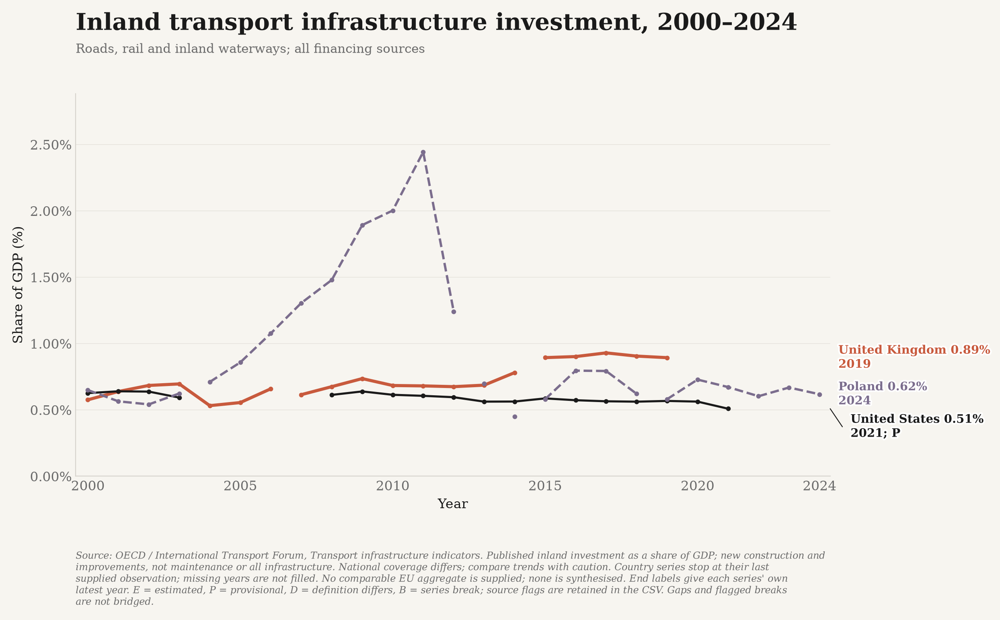
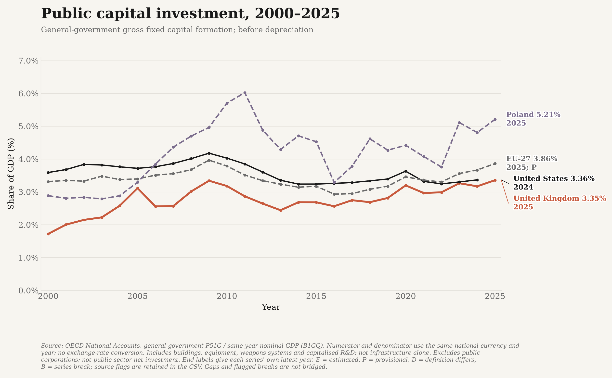
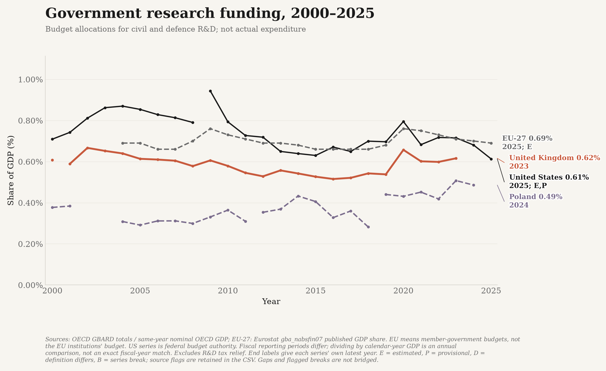
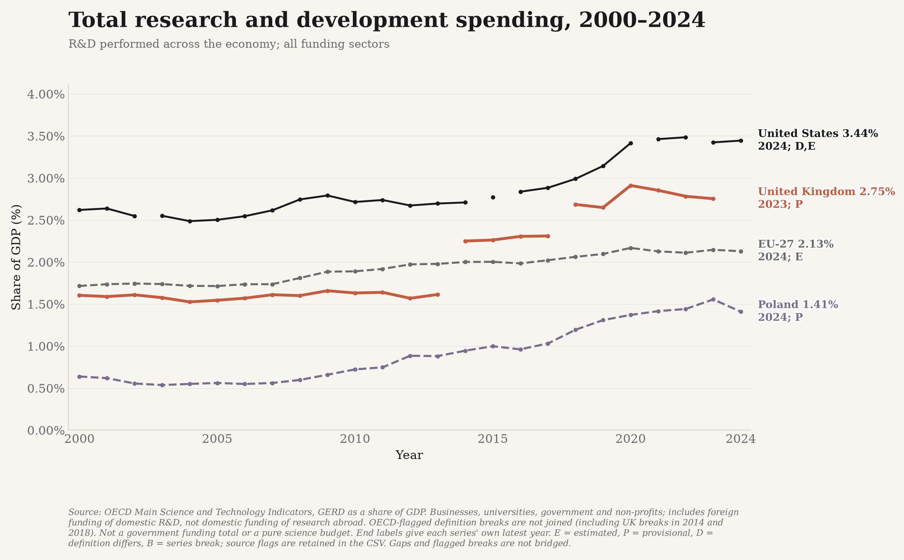
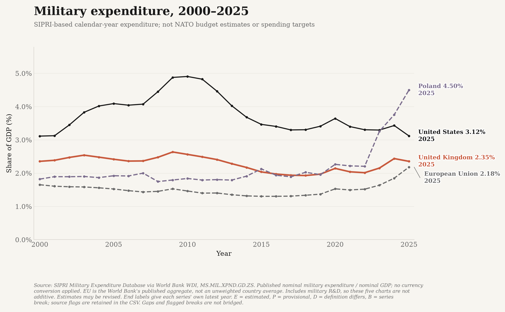

# Infrastructure investment, research funding and defence

Five separate time-series comparisons, all expressed as **percentages of GDP**.
They measure different things and must not be added together. In particular, military
R&D is included in military expenditure, government research budgets can finance R&D
performed in other sectors, and public fixed investment includes some capitalised R&D.

The UK, US, Poland and an official EU aggregate are included wherever the source
supplies comparable observations. Each line ends at its own last observation, with
the year shown in its end label. Missing years and source-flagged methodology breaks
are not connected. There is no extrapolation, interpolation or substitution of a
different measure to make a country appear up to date.

## Inland transport infrastructure investment



**OECD / International Transport Forum, Transport infrastructure indicators**,
`DSD_INDICATORS@DF_INFRASTRUCTURE`, measure `INVESTMENT`, mode `TOT_INL`,
unit `PT_B1GQ`. This is the source's published GDP-share indicator, not a ratio
reconstructed using exchange rates or a separately revised GDP series.

It covers inland transport construction and improvements, including roads, rail and
inland waterways, with all financing sources; it is **not** maintenance spending,
energy/water/digital infrastructure, all government capital spending, or a measure
of infrastructure quality. National reporting coverage differs, so trends deserve
more weight than a precise ranking of levels.

**Important source limitation:** at the initial October 15, 2026 retrieval, the UK
series ends in **2019**, the US in **2021**, and Poland in **2024**. US observations
for 2004-2007 are missing. No comparable EU aggregate is supplied in this flow; none
is manufactured from a partial selection of member states. These historical end
dates are not presented as current-year spending.

## Public capital investment



**OECD National Accounts**:

- Numerator: `DSD_NASEC10@DF_TABLE12`, `S13`, `P51G`, debit, current prices.
- Denominator: `DSD_NAMAIN10@DF_TABLE1_EXPENDITURE`, `S1`, `B1GQ`, current prices.
- Calculation: **100 x general-government gross fixed capital formation /
  same-country, same-calendar-year nominal GDP**.

Both inputs are converted from their reported unit multipliers to full units and
must use the same currency (GBP, USD, PLN or EUR). There is **no exchange-rate
conversion**. The saved data preserve the numerator, denominator, currency, exact
series identifiers and URLs, so every plotted ratio can be reconstructed.

This is **gross**, before depreciation. It includes government buildings, equipment,
weapons systems and capitalised research, not just infrastructure. It excludes
public corporations outside general government and is not the UK public-sector
**net** investment series in the separate austerity chart. The EU line uses the
published fixed-composition EU-27 aggregate, not an unweighted average.

## Government research funding



**Government budget allocations for R&D (GBARD)**, including civil and defence
objectives and general university funds. These are budget allocations, **not**
actual research spending, all government support, or only research performed in
government laboratories. R&D tax relief is excluded.

For UK, US and Poland, the source is **OECD Research and Development Statistics**,
`DSD_RDS_GOV@DF_GBARD_NABS07`, measure `C`, total socio-economic objective and funding
mode, current national currency. The ratio uses the same year's nominal OECD GDP,
with the same currency and unit-multiplier checks as public investment.

**Fiscal periods differ:** the numerator follows each source's annual budget-year
convention; GDP is calendar-year GDP for that published year. The chart therefore
compares annual budget effort, not precisely matched fiscal-year flows. The
**US series is federal budget authority**, not every state/local research budget.
These differences remain caveats rather than being silently relabelled.

The **EU-27** line is Eurostat's directly published GDP share from
`gba_nabsfin07`, `nabs07=TOTAL`, `unit=PC_GDP`, `geo=EU27_2020`. This is the
aggregate of member-government budgets, **not the EU institutions' own budget**.
The EU OECD current-PPP budget total is deliberately not divided by an unrelated
euro GDP series. Both providers use the Frascati GBARD framework.

Initial coverage: UK 2000-2023; US 2000-2025; Poland 2000-2024, with genuine gaps
in 2002 and 2003; EU-27 2004-2025. Preliminary/estimated allocations retain their flags.

## Total research and development spending



**OECD Main Science and Technology Indicators**, `DSD_MSTI@DF_MSTI`, measure `G`
(gross domestic expenditure on R&D, GERD), unit `PT_B1GQ`. Use the source's published
GDP shares, without a second conversion or a separately sourced denominator.

Includes R&D performed domestically by businesses, universities, government and
non-profits, regardless of funding origin. Includes foreign funding of domestic
research; excludes domestic money funding research abroad. It is not just public
funding, university funding or basic science.

Initial UK coverage ends in 2023; US, Poland and EU-27 in 2024. This is the latest
coverage in the selected harmonised OECD flow, not a claim that newer national
statistics do not exist. Newer ONS national releases are **not spliced** onto the
OECD line. UK source-flagged breaks in 2014 and 2018, and all other published break
flags, separate the lines; the observations themselves remain visible.

## Military expenditure



**SIPRI Military Expenditure Database via World Bank WDI**,
`MS.MIL.XPND.GD.ZS`, UK/US/Poland/EU country codes `GBR`, `USA`, `POL`, `EUU`.
The initial live response covers 2000-2025 for all four.

This is the source's published calendar-year military-expenditure/GDP ratio:
nominal local-currency spending divided by nominal local-currency GDP. It is
**not** NATO's differently defined defence estimates, an announced budget,
a spending target, nominal dollars, a PPP level, or military capability.
The EU line is the World Bank's published aggregate, not a synthetic country mean.
SIPRI estimates and historical revisions remain part of the source.

Attribute SIPRI and the World Bank when reusing the figure. Consult SIPRI's data
terms, including its commercial-use licensing provisions, for the intended reuse.

## Sources and definitions

- [OECD infrastructure investment definition](https://www.oecd.org/en/data/indicators/infrastructure-investment.html)
- [ITF comparability and transport investment methodology](https://itf-oecd.org/evolution-transport-infrastructure-investments-financial-crisis)
- [OECD government investment definitions](https://www.oecd.org/en/publications/government-at-a-glance-2025_0efd0bcd-en/full-report/government-investment-spending_023c3a29.html)
- [OECD R&D statistics and government budgets](https://www.oecd.org/en/data/datasets/research-and-development-statistics.html)
- [OECD GBARD, R&D tax relief and GERD definitions](https://www.oecd.org/en/publications/restoring-public-finances_fbcf9161-en/full-report/research-and-development_5936512a.html)
- [Eurostat GBARD metadata](https://ec.europa.eu/eurostat/cache/metadata/EN/gba_simsgb_ee.htm)
- [US federal GBARD source and budget-year definitions](https://ncses.nsf.gov/data-collections/federal-budget-function/2024-2026)
- [OECD total R&D definition](https://www.oecd.org/en/data/indicators/gross-domestic-spending-on-r-d.html)
- [ONS national R&D release and methodology scope](https://www.ons.gov.uk/economy/governmentpublicsectorandtaxes/researchanddevelopmentexpenditure/bulletins/ukgrossdomesticexpenditureonresearchanddevelopment/2024)
- [World Bank military-expenditure metadata](https://databank.worldbank.org/metadataglossary/world-development-indicators/series/MS.MIL.XPND.GD.ZS)
- [SIPRI database, calendar-year methods and terms](https://www.sipri.org/databases/milex)

The saved CSV includes source observation flags: **B** break, **D** differing
definition, **E** estimate, **P** provisional. Multiple flags are preserved.
Forecast-flagged values and incomplete current calendar years are excluded.
Shares of GDP measure the allocation of economic resources, **not inflation-adjusted
spending volumes**; a share can rise because GDP falls.

## Reproduce and refresh

```bash
python -m investment_data
python -m investment_data --from-csv data/investment_funding_long.csv
pytest tests/test_investment.py -q
```

The complete saved input is `data/investment_funding_long.csv`. All five charts and
their hash-bound hover data are in `outputs/investment/`; article-background copies
are in `outputs/page_background/investment/`. The scheduled complete-source refresh
includes this module. A failed/partial fetch cannot replace the saved CSV or silently
drop previously published observations.
