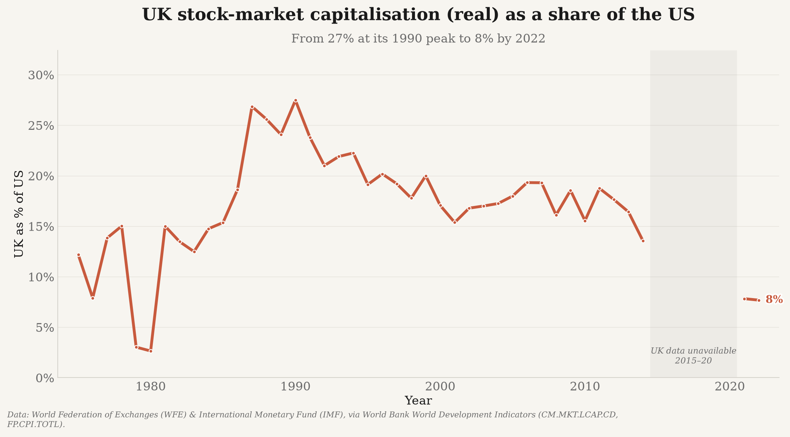
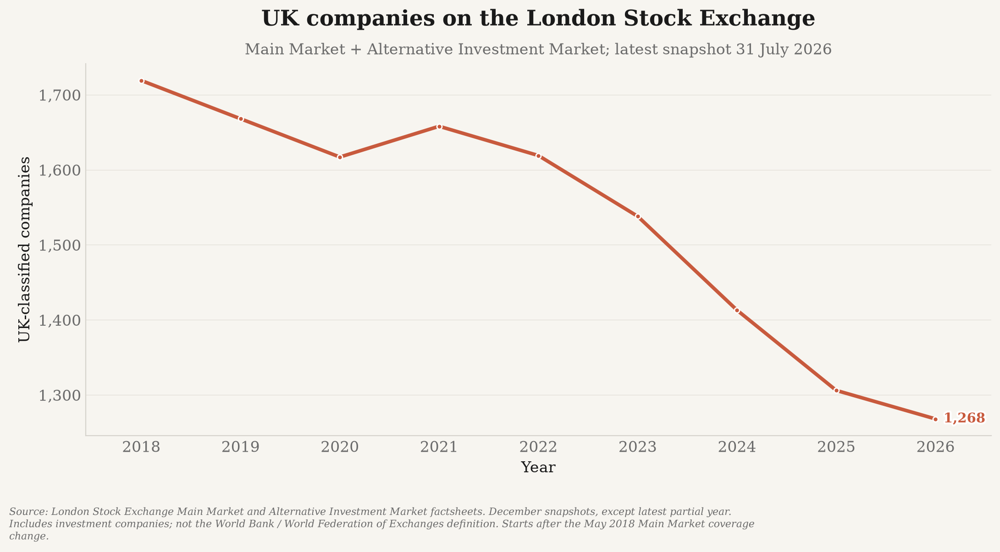

# markets_data — UK vs US stock-market size

Documents the relative decline of the UK stock market vs the US (with World / EU / Japan /
China for context), using **only real, publicly-sourced data** from the World Bank's World
Development Indicators (no API key), alongside a separate current UK company-count
series from London Stock Exchange factsheets.

## Headline results (figures in [`../outputs/stock_markets/`](../outputs/stock_markets))



The UK's listed-market capitalisation has fallen sharply relative to the US — from a peak of
~27% (1990) to ~8% by 2022. Charts cover market cap (nominal & real US$), market cap as a
share of GDP, and the number of listed domestic companies.

| File | Shows |
|---|---|
| `stock_market_cap_usd.png` / `_real.png` | Market cap, current US$ / constant 2024 US$ (CPI-deflated). |
| `stock_market_cap_pct_gdp.png` | Market cap as a share of GDP. |
| `stock_listed_domestic_companies.png` | Number of listed domestic companies. |
| `stock_lse_uk_companies.png` | LSE-classified UK companies on Main Market + AIM, 2018–2026; separate from WDI. |
| `stock_uk_us_ratio_*` | UK-as-a-share-of-US variants of the above. |

## Data source & citation

- **World Bank** (2026). *World Development Indicators* — Market capitalization of listed
  domestic companies, current US$ (`CM.MKT.LCAP.CD`); % of GDP (`CM.MKT.LCAP.GD.ZS`); listed
  domestic companies (`CM.MKT.LDOM.NO`); US CPI (`FP.CPI.TOTL`, used to deflate to constant
  2024 US$). Washington, DC: World Bank Group. Underlying data compiled by the **World
  Federation of Exchanges** and **S&P Global**. Accessed 15 August 2026.
  <https://data.worldbank.org/indicator/CM.MKT.LCAP.CD>

Real figures are the nominal series deflated by US CPI to **constant 2024 US$** (market
exchange rates, not PPP). Series have tail-year gaps (the UK is missing after 2022); values
are never spliced or interpolated. Full per-metric citations are in
[`../outputs/stock_markets/stock_market_size_summary.md`](../outputs/stock_markets/stock_market_size_summary.md).

> **Why there is no PPP twin of these charts.** The repository has a parallel PPP analysis
> ([`../ppp_data/`](../ppp_data/README.md)), but it deliberately **excludes** stock markets.
> Equity market capitalisation is the value of claims on globally-traded cash flows, priced by
> international investors in market currency; an investor selling UK shares receives dollars
> at the market rate, not at PPP. Deflating market value by a domestic consumption basket
> would answer no meaningful question.

## Current UK company counts



The overview uses the **London Stock Exchange's UK-classified company counts**,
summing Main Market and AIM. These fall from **1,719 at December 2018** to
**1,268 at July 2026**: **757 Main Market + 511 AIM** at the latest snapshot.
The separate all-nationality total is **1,502**. These are counts of companies,
not securities, new listings, market capitalisation or companies operating only in the UK.

The [Main Market reports](https://www.londonstockexchange.com/reports?tab=main-market)
and [AIM reports](https://www.londonstockexchange.com/reports?tab=aim) provide downloadable
monthly factsheets. `lse_factsheets.py` reads the Main Market's **Summary** table and
the AIM **Primary Market Summary** annual history, not its trading-activity tables.
Both files are cited for every observation. The published snapshot was retrieved
**13 October 2026**; July was the latest month verified available for both markets.

Annual points are **December month-end snapshots** through 2025. The 2026 point is
**31 July 2026**, not a full-year or December count. The overview labels all points
by year for readability; exact observation dates and retrieval dates remain in
`data/uk_listed_companies_lse.csv` and the detailed chart identifies the latest month.
The series begins at December 2018 because the Main Market factsheet's notes define
a new scope from **May 2018**: issuers with shares, depositary receipts or other
equity instruments admitted to the Main Market. Earlier summaries included companies
with no equity listed, so they are not treated as like-for-like history.

**Do not splice LSE and WDI counts.** The LSE series includes investment companies.
WDI includes foreign companies listed exclusively on an exchange and excludes funds,
unit trusts and pure holding/investment companies. Even the close 2022 overlap
(WDI **1,606** versus LSE UK-classified **1,619**) does not establish equal definitions.
The international comparison charts continue to use only WDI; the overview and the
separate LSE chart use only LSE observations. Nothing is estimated or interpolated.

The fetcher requires every requested year's Main Market and AIM counts, checks that
UK plus international equals the published total, and rejects missing, fractional or
negative counts before replacing the saved CSV.

## Usage

```bash
python -m markets_data                 # fetch + combine + charts + summary (1975..current)
python -m markets_data --no-charts     # data only
python -m markets_data.lse_factsheets --start 2018 --end 2025 --latest-month 2026-07
python scorecard.py                    # overview from saved inputs
```

Combined CSVs/manifest are written to `../data/` (git-ignored, regenerable); charts and the
trend summary are written to `../outputs/stock_markets/`.
The LSE command writes its separate CSV and chart. Without `--latest-month`, it fetches
December observations only, ending in the last completed year; a later verified
month can be requested explicitly. Use `--no-chart` for data only.

## Modules
`markets.py` · `worldbank.py` · `regions.py` · `combine.py` · `charts.py` · `summary.py` ·
`paths.py` · `_http.py` · `lse_factsheets.py`. Entry point: `python -m markets_data`.
Tests: `../tests/test_markets.py`.
