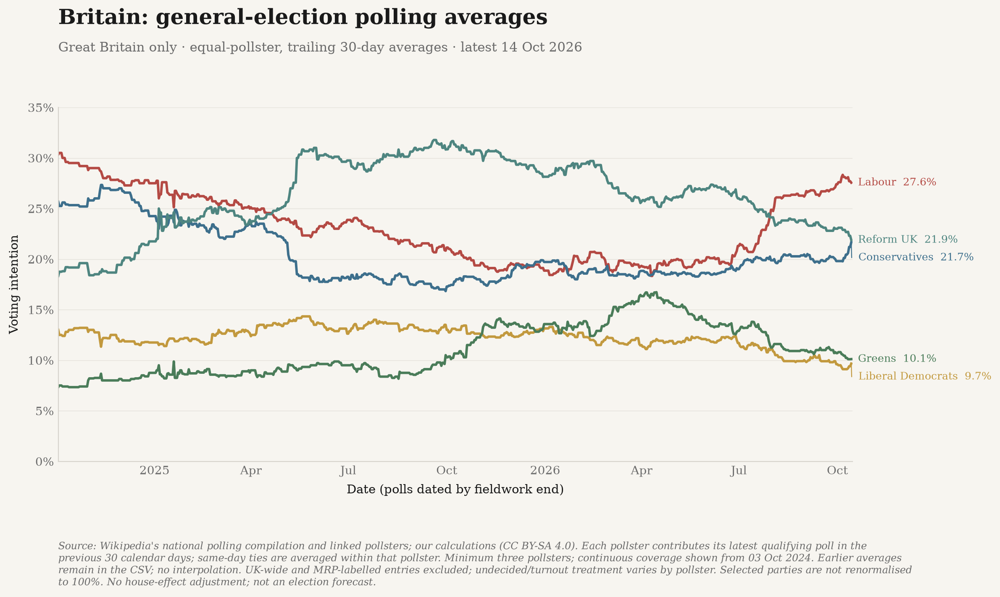

# British polling averages

National Westminster voting intention for **Labour, Conservatives, Reform UK,
Liberal Democrats and Greens** since the July 2024 general election. This is
**Great Britain**, not the whole United Kingdom: Northern Ireland and regional
polls are not mixed into the comparison.



## How the average works

For each calendar date, take qualifying polls whose **fieldwork ended on that
date or in the preceding 29 days**. Each pollster contributes its most recent
poll in that window. If a firm has several polls ending on the same latest date,
average them within that firm first. Then take the arithmetic mean across firms,
giving each firm equal weight, with the same contributors for all five parties.
Pollster names are grouped case-insensitively, ignoring spaces and punctuation.

This prevents frequent publishers from dominating a simple average of every
poll. It is not sample-size weighted and does not estimate pollster house effects.
The average CSV contains only days with **at least three pollsters**; missing
days are not filled. The chart shows the **latest uninterrupted run of qualifying
daily averages**, trimming earlier fragments rather than interpolating gaps or
joining across them. Its footnote gives the actual display start.

The calculation is post-election, with fieldwork ending from 5 July 2024 onwards.
In the initial snapshot, the first qualifying three-firm average is 7 August 2024,
but sparse early coverage creates gaps in September and early October. Continuous
chart coverage starts on **3 October 2024**. **All earlier qualifying averages
remain in the full CSV download**, along with all underlying polls in the source
CSV. The chart stops at the newest qualifying fieldwork end, rather than extending
a stale reading to today's date, and refuses a one-day-only display with no trend.

The percentages are published headline voting-intention figures, **not raw
responses from everyone surveyed**. Pollsters differ in how they handle turnout,
undecided voters, weighting and modelling. Entries explicitly labelled MRP in
the pollster field are excluded as standalone studies; this does **not** remove
all model-assisted headline estimates. In particular, YouGov's October 2026
headline results themselves use modelling. We do not harmonise those methods.
Polls with an unknown or UK-wide geographic scope, or an unreported selected
party, are excluded. They remain in the source download with an explicit reason.

The five shares are **not rescaled to total 100%**: other parties retain their
share of voting intention. A daily average is a calculation, not a new daily
poll or an official series. It is **not a prediction of an election result,
seat totals or winning probabilities**. Changes can reflect firms entering or
leaving the window as well as changes within a firm's latest poll. No confidence
band or claim of statistical significance is implied.

Dates are fieldwork-end dates, not publication dates. Historical curves are
reconstructed from the current compilation, so a poll published later can
retrospectively affect earlier dates. This is not an archive of what was known
in real time.

## Sources and provenance

The source is Wikipedia contributors' national polling tables in
[Opinion polling for the next United Kingdom general election](https://en.wikipedia.org/wiki/Opinion_polling_for_the_next_United_Kingdom_general_election).
This is a **secondary compilation**, not an official polling-average provider.
Each retained poll includes the linked underlying report/publication, its
citation, fieldwork dates, reported sample size, client, geographic scope and
party percentages. Links can point to a pollster, its client or another cited
publisher; inclusion is not an independent verification of every report.

The initial snapshot was retrieved on **18 October 2026**, with latest fieldwork
on **14 October 2026**. It contains 590 national poll entries, of which 498
qualify. The other 69 have non-GB/unknown scope and 23 are MRP-labelled studies.
The complete source HTML's SHA-256 and retrieval time are attached to every row.
No Wikipedia revision ID is inferred from the HTML.

Visible fieldwork dates take precedence over hidden HTML sort-date days/months;
the sort date supplies the end year and is retained as `fieldwork_sort_date`.
For example, the excluded 2025 Focaldata gigapoll reports 1 August-11 September
fieldwork despite a 15 September sort date. It is not shifted to that sort date.

Recent headline checks against original reports:

| Fieldwork | Pollster | Labour | Conservatives | Reform UK | Liberal Democrats | Greens |
| --- | --- | ---: | ---: | ---: | ---: | ---: |
| 14 October 2026 | [Find Out Now](https://cms.findoutnow.co.uk/app/uploads/2026/10/14th-October-VI-Find-Out-Now.xlsx) | 25% | 22% | 22% | 10% | 11% |
| 11-12 October 2026 | [YouGov](https://ygo-assets-websites-editorial-emea.yougov.net/documents/VotingIntention_Results_261012_w.pdf) | 24% | 23% | 21% | 12% | 11% |
| 9-12 October 2026 | [More in Common](https://www.moreincommon.org.uk/wp-content/uploads/2026/10/Voting-Intention-Trackers-9-12-Oct.xlsx) | 28% | 24% | 21% | 11% | 7% |

The headline figures, rather than unrounded cells or raw-response columns, are
used consistently with the compilation.

## Full data downloads

- [Underlying polls, including excluded records (CSV)](../data/gb_voting_intention_polls.csv)
- [Daily party averages and exact contributor IDs (CSV)](../data/gb_voting_intention_average.csv)

The first file also preserves all other reported result columns in
`reported_results`. A source cell spanning multiple party columns stays a
combined entry; its percentage is not falsely duplicated across parties.
The second includes the window start, pollster count, selected-poll count,
total qualifying polls in the window, method and source snapshot. Join its
`poll_ids` to the first file's `poll_id` to reproduce each daily value.

## Rebuilding and updates

```bash
python -m polling_data
python -m polling_data --from-csv data/gb_voting_intention_polls.csv
```

The first command fetches the complete source and refuses incomplete history,
a qualifying endpoint more than 45 days old, future fieldwork, conflicting
duplicates, malformed results or lost previously published poll IDs. It does
not silently fall back to saved values. The second explicitly rebuilds offline
from a saved source snapshot without claiming a new retrieval.

The `polling` step is included in the existing weekly refresh. Adding this
analysis does not advance the website's last complete source-refresh date.

## Attribution and data licence

Wikipedia contributors compiled the underlying table. Source attribution and
the linked reports are retained above and in the CSVs. The extracted compilation,
our derived-average CSV and the polling graphic/observation sidecar are made
available under [CC BY-SA 4.0](https://creativecommons.org/licenses/by-sa/4.0/).
We extracted and normalised the table, applied the eligibility/window rules
above, and created the averages and graphic; these are our changes, not
Wikipedia's or the pollsters' endorsement.

This notice applies to these polling data and graphics, not to unrelated code
or datasets. Original pollsters' reports retain their own rights and are linked,
not redistributed here. See the
[Wikimedia Terms of Use](https://foundation.wikimedia.org/wiki/Policy:Terms_of_Use#7._Licensing_of_Content)
for the compilation's reuse terms.
