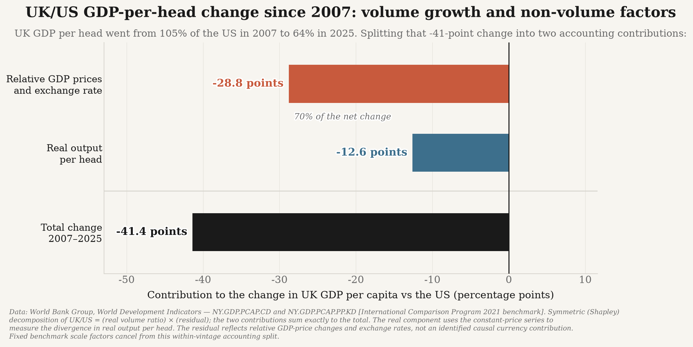
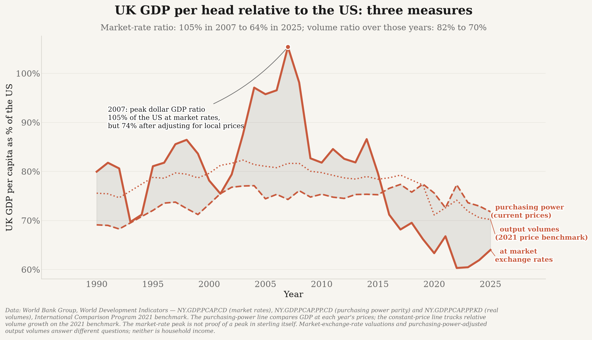
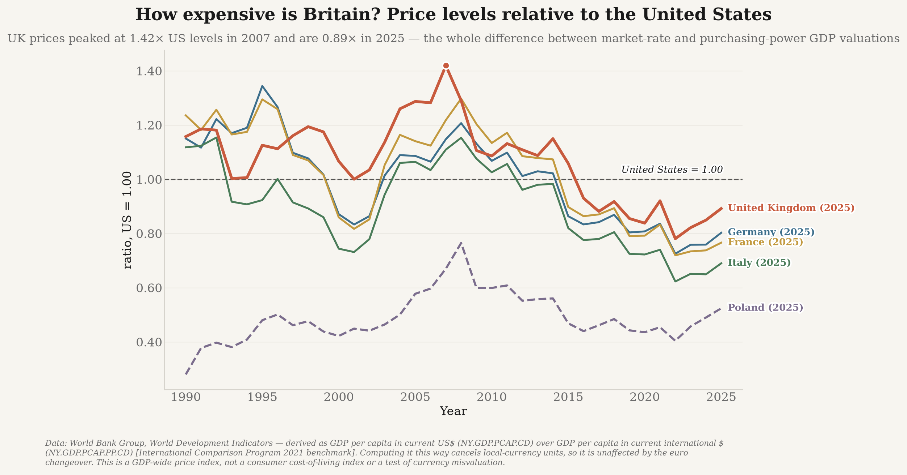
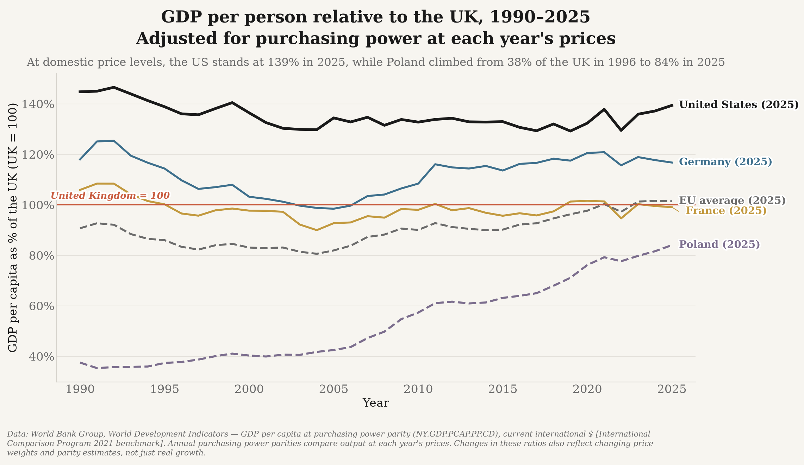
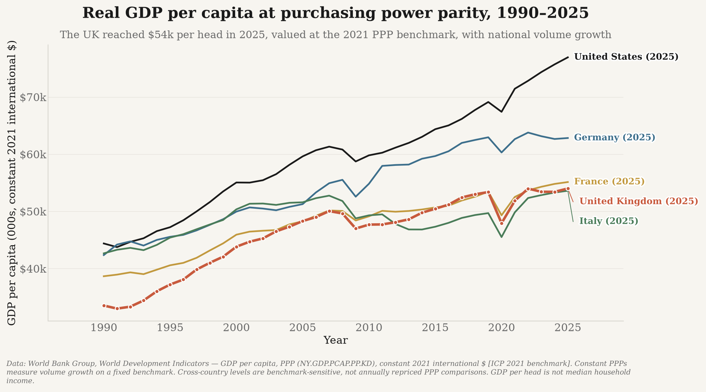
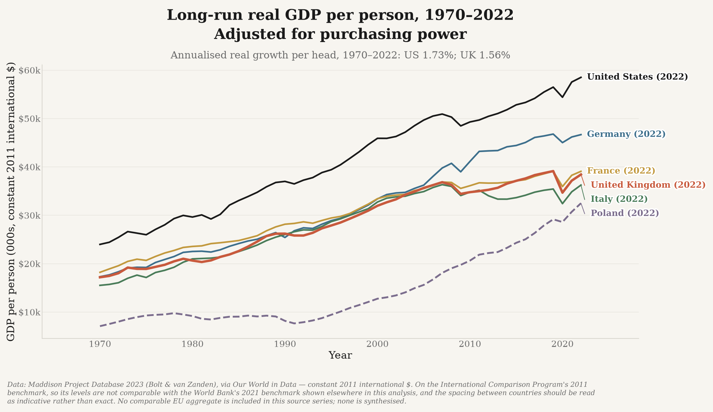
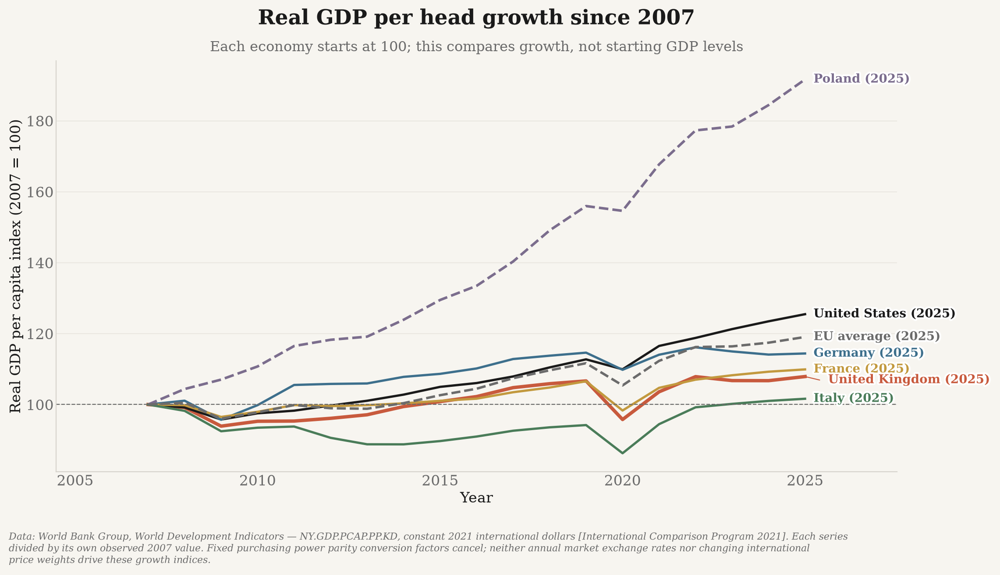
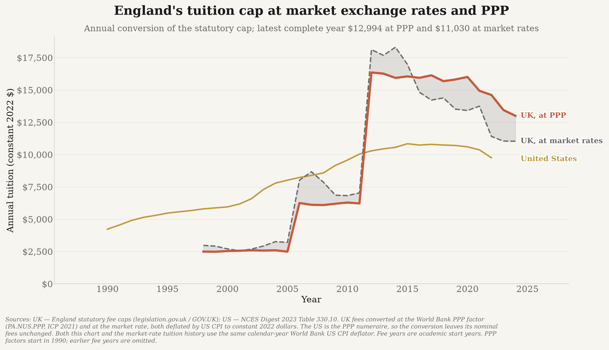
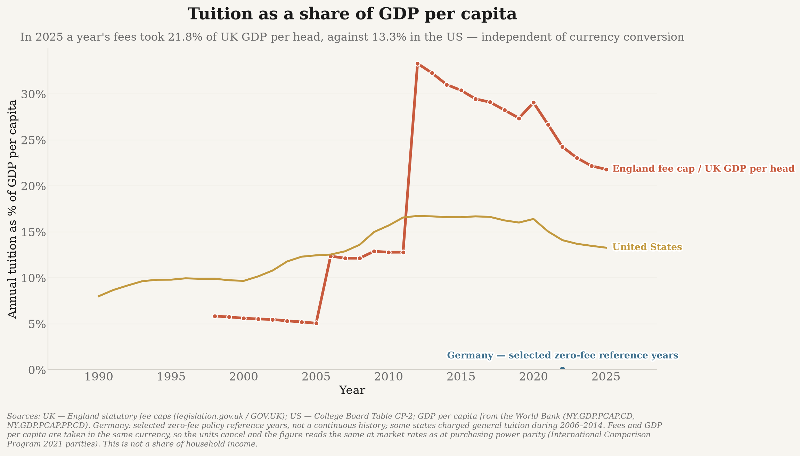

# ppp_data — the UK's decline measured at purchasing power parity

A companion to the [GDP and income analysis](../europe_data/README.md). The overview already
uses constant-price PPP; the detailed charts separately show national-accounts real
volumes and nominal market-dollar valuations.

**Current PPPs compare GDP at each year's price structure. Constant PPPs track real
volumes at the 2021 benchmark. Market dollars include annual exchange-rate and GDP-price
effects.** None is median household income, a household cost-of-living index, or a direct
measure of the goods a person can purchase at home or abroad.

All output lands in [`../outputs/ppp/`](../outputs/ppp). Run it with:

```bash
./.venv/bin/python -m ppp_data          # fetch -> validate -> CSVs -> figures
./.venv/bin/python -m ppp_data --from-csv   # re-chart without re-fetching
```

## Headline results

### Separating volume growth from non-volume factors


At market exchange rates the UK fell from **105% of US GDP per head in 2007 to 64% in 2025** —
the central fact of this repository's [GDP analysis](../europe_data/README.md). Decomposing
that 41-point fall:

| Contribution | Points |
|---|---|
| Real output per head (volume growth) | **−12.6** |
| Relative GDP prices and exchange rates | **−28.8** |
| **Total** | **−41.4** |

**Roughly 70% of the nominal ratio change is assigned to non-volume factors by this
accounting decomposition.** UK real output
per head grew **0.42% a year** from 2007 to 2025 against the US's **1.27%**, so the UK fell
**14%** behind in real volume terms.

The residual is an accounting factor, not an identified currency effect: its movement
reflects relative GDP-price changes and exchange rates. Fixed PPP benchmark rescalings
cancel from both symmetric contributions within one vintage. The
percentage-point contributions must not be read as percentage changes in real output.

The real component is measured from the **constant-price** PPP series, whose movement is pure
volume. The current-price series satisfies a tidier identity but its year-to-year movement
mixes volume growth with shifts in the PPP price structure. In this dataset it changes much
less than the constant-price ratio. `validate.py` checks the decomposition's volume wiring
and independently reconciles constant-PPP growth against `NY.GDP.PCAP.KD` for each of the
six individual countries. The EU aggregate is excluded from that reconciliation because
aggregation weights differ between PPP and dollar-valued totals.

UK real GDP per head actually **increased 7.9%** over this interval; the US increased
**25.5%**. A 14% relative shortfall is not an absolute 14% loss of UK production.

This is a genuine qualification of the headline story, and it is reported as such. It is
*not* a clean bill of health: see [what this does and does not mean](#what-this-does-and-does-not-mean).

### The three views side by side


The GDP page provides nominal and **real GDP at fixed 2021 PPPs** with
**US and EU relative to the UK (UK = 100)**. The current-price PPP comparison is
retained only as a supplemental export. A supplemental
[four-panel comparison](../outputs/gdp_income/us_uk_gdp_measures.png) retains the
UK/US audit alongside actual annual sterling exchange rates.
In 2025, US GDP per head is 156.3% of the UK in nominal
market dollars, 139.3% at current PPPs and 142.5% on the fixed-2021 volume benchmark.
The 165.9% nominal comparison refers to 2022. Do not mix these years, valuation
bases or reciprocal ratios; 156.3% of the UK means 56.3% higher, not 156.3% higher.

The shaded gap between the market-rate and PPP-level lines reflects relative price
levels **and** exchange rates, not currency alone. The UK's
2007 dollar-valued "parity with the US" is not evidence of output-volume parity: in that
year the current-PPP ratio was 74%, and the 2021-benchmark volume ratio was 82%.

The figure carries a third line deliberately. Two would invite the reading "the PPP line is
the real story, so almost nothing was lost" — but the PPP-level line is a *level* comparison
at each year's prices, and its movement is not pure volume. The dashed constant-price line is,
and it falls considerably further: from **82% of the US in 2007 to 70% in 2025**. That third
line is the quantity the decomposition chart splits out, so the two figures measure the same
thing.

### How expensive is Britain?


The GDP-wide price level index (US = 1.00) accounts for the difference between nominal
market-dollar and current-PPP GDP valuations. UK prices peaked at **1.42× US levels in 2007** and
sit at **0.89× in 2025**. This is a GDP-wide price-level comparison, not proof that
sterling was economically over- or undervalued. (Conceptually this is the PPP conversion factor over the market exchange rate;
for why it is *computed* a different way, see [below](#deriving-the-price-level-index).)

### The peer comparison changes character


PPP **narrows** the UK's gap to the US and **widens** the convergence story with Poland:

| Peer, latest year | Share of the UK at market rates | at PPP |
|---|---|---|
| Poland | 49% | **84%** |
| Germany | 105% | **117%** |
| France | 85% | **99%** |

Poland's GDP per head is closer to the UK's on this PPP measure than in market dollars.
Its current-PPP ratio rose from **38% in 1996 to 84% in 2025**. That change is not itself a
pure real-growth measure or evidence that household living standards have converged.
The indexed volume chart below answers the separate growth question.

### Where PPP estimates come from

PPP estimates combine price surveys, national accounts, interpolation and extrapolation.
Two programmes feed the World Bank series:

- The **International Comparison Program** runs global benchmark price surveys in particular
  years; this vintage incorporates **2011, 2017 and 2021**, anchored to 2021.
- For OECD and EU countries — which is *every* country plotted here — the World Bank
  additionally incorporates **annual** PPPs from the **Eurostat-OECD PPP Programme**, which
  operates a rolling price survey. Where those are unavailable it extrapolates from the
  nearest benchmark using the country's GDP deflator relative to the US.
  ([World Bank Data Help Desk](https://datahelpdesk.worldbank.org/knowledgebase/articles/665452-how-do-you-extrapolate-the-ppp-conversion-factors))

The numerical series cannot establish which country-years contain a fresh survey.
Matching or deviating from a deflator extrapolation formula does **not** prove provenance:
rounding, revisions and linked national accounts can also affect that calculation.
`metrics.PEER_COMPARISON_START_YEAR = 1996` retains the existing reporting window for the
Poland subtitle, not a survey certification. Validation instead requires overlapping
observations at the decomposition baseline and a later endpoint, and discloses that recent
PPPs may be provisional or extrapolated. An API observation is not necessarily a direct
measurement in that year.

### Levels, and the long run



The World Bank's PPP series starts in 1990. The Maddison Project reaches back to 1970 but is
benchmarked on **2011** international dollars rather than the World Bank's 2021, so it gets
its own chart and is never spliced onto the World Bank line.

Constant-PPP World Bank levels support **benchmark-valued volume comparisons** as well as
growth comparisons. They are not annually repriced PPP levels. Maddison remains separate,
with its own benchmark and historical reconstruction; these vintages are never spliced.

### Real growth without a benchmark level gap


Each country is divided by its own observed 2007 value. Fixed conversion factors cancel,
so this compares output growth rather than differences in initial GDP levels. Countries
without a 2007 observation are omitted rather than rebased to a different year.

### Tuition



The England fee cap changes only when policy changes, but both converted lines move
**every year**: the nominal statutory cap is carried through the years in which it applies,
then each year's exchange rate, PPP factor and inflation adjustment are applied separately.
Because UK prices are below US prices, the cap is generally worth more in international
dollars than in market dollars.

The second figure sidesteps the currency question entirely. Tuition as a share of GDP per
capita is unit-free — the currency cancels, so the answer is identical at market rates and at
PPP. On that basis, in **2025** (the last year both historical fee series cover)
a year's fees equalled **21.8% of UK GDP per head against 13.3% in the US**.
The US history uses the complete College Board 2025 Table CP-2 series, not a
splice onto the separate NCES collection. Both real tuition charts share the
saved BLS annual CPI-U with the tuition package; BLS's published 2025 average
uses 11 months because October data were unavailable during the shutdown.
This tuition-specific source extension does not change the GDP volume measures.
This avoids currency-conversion effects, but GDP per head is not a student's disposable
income. The ratio is an output-relative fee measure, not a household affordability estimate.
Germany is shown only at selected zero-fee reference years, not as a continuous
zero-fee history: some states charged general tuition during 2006–2014.

## Method

### The identity everything rests on

For any country, GDP per capita converted at the market exchange rate and at PPP differ by
exactly one factor, the price level index:

```
GDPpc(current US$) = GDPpc(current int'l $) × PLI       PLI = PPP factor ÷ market FX
```

Taking a ratio against the United States (whose PLI is 1.00 by construction):

```
R_market_fx = R_ppp × R_price_level
```

Here `R_ppp` is **current-price** PPP, whose movement mixes volume and PPP price structure.
Production instead uses `R_market_fx = R_volume × residual`, with constant-PPP volumes.
`ppp_data/decompose.py` splits that product using the symmetric (Shapley) decomposition of a
two-factor product, which is exact and independent of which factor you vary first — there is
no arbitrary "hold X constant" choice biasing the result. The two contributions sum to the
total exactly, and the tests assert it.

### Which series is valid for which question

This is the easiest thing to get wrong, so it is enforced in code rather than left to
memory. Every metric in `ppp_data/metrics.py` declares whether it is valid as a level over
time, as a same-year cross-country ratio, or neither; `require_over_time` and
`require_cross_section` raise if a chart asks for the wrong one.

| Series | Level over time | Same-year ratio | Why |
|---|---|---|---|
| `NY.GDP.PCAP.PP.KD` (constant 2021 int'l $) | ✅ | ✅, benchmark-valued volumes | National volume growth at fixed PPP conversion, not annually repriced levels |
| `NY.GDP.PCAP.PP.CD` (current int'l $) | Not real growth | ✅ | Annual price structure; a rising nominal level partly reflects price changes |
| `NY.GDP.PCAP.KD` (constant 2015 US$) | ✅ | Not a PPP comparison | National-accounts real growth and an independent check of PPP growth |
| `NY.GDP.PCAP.CD` (current US$) | Nominal valuation only | ✅ | GDP prices and annual market FX, not real growth |
| `price_level_index` | ✅ | ✅ | A unit-free ratio |
| `gdp_per_capita_real_maddison` (2011 int'l $) | ✅ | ❌ | A different ICP vintage; own chart only |

### Deriving the price level index

The index is derived as **`NY.GDP.PCAP.CD ÷ NY.GDP.PCAP.PP.CD`**, not as the more obvious
`PA.NUS.PPP ÷ PA.NUS.FCRF`. Both are algebraically the same quantity, but in the first the
country's local-currency GDP cancels, so the result is immune to redenominations.

That matters, and it was found by the validation rather than assumed: **for euro-area
countries before 1999 the World Bank quotes `PA.NUS.PPP` in euro but `PA.NUS.FCRF` in the
legacy national currency.** The direct ratio is then wrong by the legacy conversion rate —
for Italy in the 1990s, by a factor of nearly 2,000, producing a "price level" of 0.0005.

Both routes are computed. The direct one is kept as `price_level_index_direct`, is flagged
`validation_only` so it can never be plotted, and exists purely so that
`validate.check_price_level_agreement` can cross-check the headline index from two
separately fetched pairs of World Bank series, not statistically independent estimates.
The 27 country-years where they legitimately
disagree are enumerated in `validate.CURRENCY_BASIS_BREAKS`; a disagreement anywhere else
fails the run.

## Validation

`python -m ppp_data` runs sixteen checks and **refuses to write figures if any fails at error
level**. This is the answer to "do these PPP numbers actually make sense?":

| Check | What it would catch |
|---|---|
| `no_duplicates` | Double-counting on re-fetch |
| `decomposition_real_is_volume` | The bar labelled "real output" not actually equalling the real-output divergence — recomputed from each country's own growth rates |
| `headline_year_coverage` | A missing nominal or volume observation at the baseline or a later common endpoint |
| `constant_ppp_growth` | Wrong volume wiring or conflicting national-accounts vintages; compares growth with independently fetched `NY.GDP.PCAP.KD`, allowing at most 0.2 percentage points per interval |
| `ppp_estimate_provenance` | Reports that numerical values cannot certify country-year survey provenance |
| `coverage` | A plotted country silently missing its series |
| `sources_present` | An unattributed row |
| `us_is_numeraire` | US price level index ≠ 1.00 — the numeraire misidentified |
| `price_level_identity` | `GDPpc(US$) = GDPpc(int'l $) × PLI` broken in the emitted data — a year misalignment or truncation between the three GDP series |
| `price_level_agreement` | The two independent routes disagreeing: wrong series, misaligned years, or a currency-basis break; also fails if fewer than 60% of country-years can be cross-checked at all |
| `benchmark_year_agreement` | Constant- and current-price PPP ratios diverging in the ICP benchmark year |
| `plausible_ranges` | Order-of-magnitude errors, misplaced decimals, wrong indicator |
| `relative_price_levels` | Same-year historical ordering changed (warning only); missing comparable inputs remain errors |
| `ppp_beats_market_fx_for_poland` | Changed historical ordering (warning), not a requirement that Poland remain cheaper forever |
| `metric_units` | A constant-price series written out under a current-price label |
| `spot_values` | A large upstream revision moving well-known published values |

A representative passing run:

```
[PASS] us_is_numeraire: US price level index over 36 years; furthest from 1.00 is 1.000000000
[PASS] price_level_agreement: checked 216 country-years; worst agreeing error 0.17% (POL 1993);
       27 disagreement(s) explained by a documented currency changeover
[PASS] benchmark_year_agreement: UK/US PPP ratio in 2021: 0.7256 (current prices) vs 0.7256
       (constant 2021 prices), differing by 0.00%
```

## Caveats

| # | Hazard | How it is handled |
|---|---|---|
| A | Current international $ embed price changes | Barred from real-output level charts by `require_over_time`; enforced by test |
| N | **PPP estimates combine surveys and extrapolation** | No universal survey-era boundary is inferred from arithmetic; checks require actual series coverage and report provenance limitations |
| O | **"Real" can mean two different things.** The current-price PPP ratio moves with both volume growth *and* the PPP price structure; only the constant-price series is pure volume | The decomposition's real component uses the constant-price series, and `decomposition_real_is_volume` recomputes the divergence from each country's own growth rates and fails if they disagree |
| B | **ICP benchmark revisions** (2011 → 2017 → 2021) shift levels *retroactively* | Vintages are never spliced; every figure names its vintage in the source note. Figures here are **not** comparable with PPP numbers published under an earlier round |
| C | Maddison uses the 2011 benchmark | Its own chart; never joined to a World Bank line |
| D | World Bank PPP starts in 1990 | PPP charts start in 1990 and say so; Maddison covers the earlier period separately |
| E | Constant PPPs are valued at a fixed benchmark, not each year's prices | Label benchmark-valued ratios explicitly; use current PPPs for annual price structures and own-country indices for growth |
| F | **PPP is not "the truth", it is a different question** | Figures state their basis; the tuition share-of-GDP measure is not a household-income share |
| G | PPP-converting equity market cap is meaningless | Stock markets excluded — see below |
| H | Eurostat **PPS** (EU27 = 100) ≠ World Bank **international $** (US-referenced) | Never plotted on the same axis |
| I | The EU row is a World Bank aggregate, not a country | Labelled "EU average"; not a synthesized unweighted mean, and excluded from single-currency FX/price-level lookups |
| J | GDP-price and exchange-rate changes both affect dollar valuations | The decomposition measures their combined residual, not an isolated causal sterling effect |
| K | Tuition mixes a *specific* price with an *economy-wide* PPP basket | Footnoted, and paired with the basket-free share-of-GDP chart |
| L | Missing years and country gaps | No interpolation, forward-filling, or splicing — the observation is dropped |
| M | `PA.NUS.PPP` and `PA.NUS.FCRF` share a currency basis only after the euro changeover | The index is derived by a route where currency units cancel; the direct route is validation-only |

### Why stock markets are excluded

`markets_data` is deliberately **not** given a PPP twin. Equity market capitalisation is the
value of claims on globally-traded cash flows, priced by international investors in market
currency. Deflating it by a domestic consumption-basket PPP would answer no meaningful
question — an investor selling UK shares receives dollars at the market rate, not at PPP.
This matches the existing caveat in `markets_data/markets.py`.

The same reasoning excludes tax-to-GDP, London's share of UK GDP, and the NHS, rail, crime,
age, trust, and migration analyses: they are ratios, rates, or counts, where the currency has
already cancelled and PPP has nothing to contribute.

### What this does and does not mean

The nominal ratio changed much more than the real-volume ratio. That does not make the
valuation change irrelevant, but this decomposition cannot identify effects on import
prices, household welfare or the terms of trade. Those require their own price and income
data. GDP per capita also hides distributional changes, unpaid work and other welfare
dimensions. The volume comparison demonstrates slower UK growth relative to the US, not
an absolute loss of all the output represented by the percentage-point bar.

## Methodology and contemporary research

Reviewed on **12 October 2026**:

- [World Bank indicator metadata](https://data.worldbank.org/indicator/NY.GDP.PCAP.PP.KD)
  defines constant PPP GDP per head as a real volume measure. Metadata for
  `NY.GDP.PCAP.PP.CD` explicitly describes current prices and linked national accounts.
- [World Bank ICP FAQ](https://www.worldbank.org/en/brief/2020/05/19/faq) distinguishes
  spatial PPP comparisons from temporal growth, recommending national-accounts constant
  measures for growth rather than comparing separate ICP benchmark releases.
- [World Bank extrapolation guidance](https://datahelpdesk.worldbank.org/knowledgebase/articles/665452-how-do-you-extrapolate-the-ppp-conversion-factors)
  describes GDP-deflator extrapolation and annual Eurostat-OECD rolling surveys. It does
  not establish 1996 as a universal country-year survey boundary.
- [Eurostat-OECD Methodological Manual on PPPs, 2023 edition](https://www.oecd.org/en/publications/eurostat-oecd-methodological-manual-on-purchasing-power-parities-2023-edition_c9829192-en.html)
  treats PPPs as tools for comparing GDP price and volume levels. GDP-wide conversion
  should not be presented as a household consumption-price measure.
- [ONS, GDP first quarterly estimate, April to June 2026](https://www.ons.gov.uk/economy/grossdomesticproductgdp/bulletins/gdpfirstquarterlyestimateuk/apriltojune2026),
  published **13 August 2026**, reports GDP per head in chained volume measures and
  compares G7 real growth using OECD data. This is the same temporal-volume approach
  used here, rather than nominal dollars divided by US CPI. ONS also documents population
  revisions and uncertainty; the series is not a measure of median household income.

The annual WDI snapshot and ONS quarterly releases can differ in population estimates,
vintage and revision timing. Methodological agreement does not imply identical rounded
growth figures. The **8 October 2026 WDI release** supplies the current charts through 2025;
quarterly 2026 observations are not appended to annual lines.

## Sources

All free, no API key, fetched live. Data accessed via the World Bank API; see
`data/ppp_manifest.json` for the exact run.

- **World Bank** (2026). *World Development Indicators.* Washington, DC: World Bank Group.
  - `NY.GDP.PCAP.PP.KD` — GDP per capita, PPP (constant 2021 international $)
  - `NY.GDP.PCAP.PP.CD` — GDP per capita, PPP (current international $)
  - `NY.GDP.PCAP.CD` — GDP per capita (current US$)
  - `NY.GDP.PCAP.KD` — GDP per capita (constant 2015 US$, national-accounts growth check)
  - `PA.NUS.PPP` — PPP conversion factor, GDP (LCU per international $)
  - `PA.NUS.FCRF` — Official exchange rate (LCU per US$, period average)
  - `FP.CPI.TOTL` — Consumer price index (US, used as the deflator)

  PPP estimates derive from the **International Comparison Program (ICP)**, 2021 round, and
  — for the OECD/EU countries plotted here — from the **Eurostat-OECD PPP Programme**'s
  annual rolling price survey. Availability varies by country and year; the values alone
  do not certify which observations are survey-based.
  <https://data.worldbank.org/indicator/NY.GDP.PCAP.PP.KD>
- **Bolt, J. & van Zanden, J. L.** (2024). *Maddison Project Database 2023*, via Our World in
  Data. Real GDP per capita in constant 2011 international $.
  <https://ourworldindata.org/grapher/gdp-per-capita-maddison>
- **Tuition:** England statutory fee caps (legislation.gov.uk / GOV.UK);
  College Board *Trends in College Pricing 2025*, Table CP-2. Read from
  `data/processed/tuition_history.csv`, built by [`../tuition`](../tuition/README.md).
  Inflation uses the saved `data/raw/bls_us_cpi_annual.csv` (BLS CPI-U
  `CUUR0000SA0`, annual `M13`), including for offline re-charting.

## Layout

```
ppp_data/
  __init__.py      package docstring: what this parallel analysis is, and is not
  paths.py         filesystem paths: regenerable CSVs to data/, figures to outputs/ppp/
  metrics.py       metric registry: units, ICP vintage, per-metric validity + caveats
  peers.py         which countries are plotted, and in what colour
  worldbank.py     World Bank client + the two derived price level indices
  maddison.py      long-run PPP series (re-labelled from europe_data.maddison)
  series.py        slicing tidy rows into per-country series and ratios
  decompose.py     the symmetric real-vs-price-level decomposition
  validate.py      the sixteen sanity checks
  combine.py       long/wide CSVs + manifest
  figure.py        shared chart helpers (wrapped notes, non-colliding end labels)
  charts.py        the seven GDP and price-level figures
  tuition_ppp.py   the two tuition figures
  __main__.py      fetch -> validate -> combine -> chart
```

Tests: `tests/test_ppp.py` (59 tests, fully offline).
