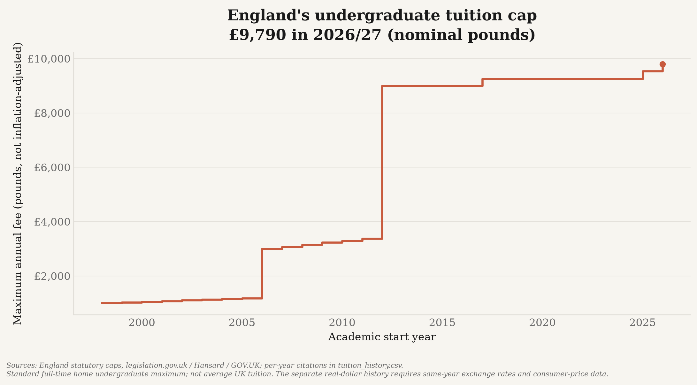

# Tuition sub-analysis — cost of a four-year degree: UK vs EU vs US

Part of the `uk_decline` study. Determines the **median** and **average** cost of a
four-year bachelor's degree across the **UK**, the **EU-27**, and the **US**, to test the
claim that *the UK has a higher average cost of degrees*.

> **On this mixed-definition snapshot**, England's maximum annual
> tuition (~**$12,890**, the published £9,790 cap for 2026/27, converted at nearby-year FX) is **higher than both**
> the EU country-compilation mean (~**$442/yr**, median **$0**) and the US average published **in-state public** tuition
> (~**$11,950/yr**, 2025/26). This compares a statutory maximum with a US institutional average
> and an unweighted EU country compilation, not like-for-like student averages.
> England's cap is not a UK-wide average; rules differ in Scotland, Wales and Northern Ireland.

## Scope

| Dimension | Choice |
|---|---|
| Cost | **Tuition / fees only** (no living costs) |
| Cohort | **Domestic / in-country (EU) students** at public institutions |
| Regions | **UK** (own category), **EU-27**, **US** |
| Aggregation | **Per country, unweighted** median & average |
| Degree totals | Summary table: annual tuition **× 4** normalized; chart annotations: typical 3-year UK/EU and 4-year US |
| Currency | normalized to **USD** (nominal, market FX) and **constant 2022 USD** (CPI-adjusted) |

## Results

The current England statutory cap is **£9,790 for 2026/27**. The overview and
the following chart show it directly in **nominal pounds**, so a current policy
value is not hidden by unavailable annual inflation or exchange-rate data.
This is the standard full-time maximum for eligible providers, not every student's
actual bill or an inflation-adjusted measure.



Dated cross-country compilation (nominal USD, annual domestic tuition, one figure
per country): **EU 2023/24–2026/27, US 2025/26, England 2026/27**. Six EU
entries use newer national sources; the remaining 21 retain their dated 2023/24
references. This is not a uniformly current EU dataset.

| Region | n | Avg / yr | Median / yr | Avg 4-yr | Median 4-yr |
|---|---:|---:|---:|---:|---:|
| **UK** | 1 | $12,890 | $12,890 | $51,562 | $51,562 |
| **EU-27** | 27 | $442 | $0 | $1,768 | $0 |
| **US** | 1 | $11,950 | $11,950 | $47,800 | $47,800 |

Constant-2022-USD values use the tuition source year's **BLS annual CPI-U**.
The US 2025/26 snapshot is **$10,863 in 2022 dollars**. BLS's published 2025
annual average uses 11 months because October collection was suspended during the
federal shutdown; it is used as published, not reconstructed or interpolated.
England and four EU entries dated 2026 remain blank in the real snapshot until
annual 2026 CPI is available. Consequently that chart's EU mean covers **23 of
27 countries**, not the full EU compilation; it is not comparable with the
27-country nominal mean as a measure of change.
Market exchange rates express fees in US dollars at the year's exchange rate.
GDP PPP expresses them against an economy-wide purchasing-power basket, not a
tuition-specific price index. The two answer different questions; neither alone
measures student affordability.

> **The PPP alternative, for comparison.** [`../ppp_data/`](../ppp_data/README.md) builds a
> PPP-converted twin of the history chart, plus a **tuition-as-a-share-of-GDP-per-capita**
> chart that is unit-free (the currency cancels, so it reads the same at market rates and at
> PPP). The PPP chart carries the legally fixed nominal cap through every applicable year,
> then recomputes each year's PPP, market-rate and inflation-adjusted value; it does not draw
> flat real-value steps between policy changes. In 2025 — the last year both historical
> fee series cover — a year's fees took **21.8% of UK
> GDP per head against 13.3% in the US**.

Full per-country data: `data/processed/tuition_by_country.csv`.
Region summary: `data/processed/summary.csv`.

## Historical trend — real (inflation-adjusted) tuition back to the 1970s

The snapshot above is a nominal cross-section. The **US/England primary-sourced, inflation-
adjusted** view is the historical series in **constant 2022 USD** (`../outputs/tuition/tuition_history_real_usd.png`):

England's source file records statutory change points, including annual upratings before
2012 ([Hansard, 1 March 2013](https://publications.parliament.uk/pa/cm201213/cmhansrd/cm130301/text/130301w0003.htm)).
The pipeline carries each legally
fixed **nominal** cap through the years in which it applies, then recalculates the market
exchange-rate and inflation-adjusted value annually; real-dollar values are not held flat.

| Year | UK (England cap) | US (public in-state) | Germany |
|---|---:|---:|---:|
| 1971 | $0 (free) | $3,107 | $0 |
| 1998 | $2,973 | $5,835 | $0 |
| 2012 | **$18,122** | $11,026 | $0 |
| 2022 | $11,401 | $10,990 | $0 |
| 2023 | $11,043 | $10,863 | — |
| 2024 | $11,030 | $10,832 | — |
| 2025 | $11,413 | $10,863 | — |

**Key finding:** in real terms the UK went from **free (until 1998)** to **overtaking US
public college in 2012** ($18,122 vs $11,026). The cap stayed at £9,250 from 2017 through
2024/25, then rose to £9,535 in 2025/26. The real-dollar history now includes
2025/26; the 2026/27 cap remains nominal-only until same-year annual FX and CPI exist. Germany
has zero-fee reference observations plotted as points, not an uninterrupted free series:
some German states charged general tuition during 2006–14. Germany is not an EU average.

Historical data: `data/processed/tuition_history.csv`.

The US line uses the **complete College Board 2025 Table CP-2 nominal history
(1971/72–2025/26)**, not NCES with newer College Board points appended. Its own
source changes from NCES/IPEDS with full-time-equivalent weights to College
Board's Annual Survey of Colleges with full-time undergraduate weights in
1987/88; the chart breaks the line at that boundary without dropping either
observation. The separate NCES Digest table is retained as a reference source,
not merged into this line.

## Data sources & provenance

**Full formal citations** (organization, title, year, access date) are in
**[`CITATIONS.md`](CITATIONS.md)**. Every figure is traceable to the source
below (each output CSV row also carries `source` / `source_url`). **Primary** =
fetched/derived from an authoritative primary dataset;
**secondary** = compiled from a published summary of the primary report (flagged for
verification in-row).

| Series | Source | Access | Provenance |
|---|---|---|---|
| US tuition history | **College Board** 2025, Table CP-2, complete nominal public four-year in-state series | `fetch_collegeboard.py`; collection/weighting break in 1987/88 | **primary publisher table** |
| Separate US reference | **NCES** Digest 2024, Table 330.10, through 2023/24 | `fetch_nces.py`; raw constant-dollar column labelled 2023/24 academic-year dollars | **primary** |
| US tuition snapshot | **College Board**, *Trends in College Pricing 2025*, Table CP-1 | Published 2025/26 averages: public in-state $11,950; private nonprofit $45,000 (reference only) | **primary publisher table** |
| UK fee-cap history | England statutory caps — Acts / SIs on **legislation.gov.uk** (1998, 2004, 2010, 2016), Hansard 1 March 2013 annual maxima, and House of Commons Library CBP-8151 | `data/raw/tuition_history_manual.csv` (per-row `source_url`) | **primary** (statutory / parliamentary answer) |
| Inflation | **BLS** annual CPI-U, `CUUR0000SA0`, published `M13` annual averages | `tuition/cpi.py`; saved 1963–2025 series shared by snapshot, market-rate history and PPP tuition charts | **primary** |
| Exchange rates | **World Bank** `PA.NUS.FCRF` (keyless API) | `tuition/rates.py` (`fetch_series`) | **primary** |
| EU snapshot fees | Six national sources plus **Eurydice** 2023/24 summary for 21 countries | `data/raw/manual_tuition.csv`; dates and definitions retained per row | **mixed primary / secondary** |
| Germany history | German HE fee history / Eurydice | `data/raw/tuition_history_manual.csv` | secondary |

> **Honesty note:** the EU-27 snapshot fees come from a published *summary* of the Eurydice
> report, not the primary PDF, except the six nationally sourced updates. Bulgaria
> remains marked `APPROXIMATE`; Spain now uses the ministry's **€15.37 mean
> first-enrolment credit price × 60 credits = €922.20**, a standardized annual
> equivalent, not an average student's bill. Belgium
> uses the Flemish Community rather than a national average. US nominal fees and England caps are primary-sourced and deflated with
> the **same calendar-year BLS US CPI**, not mixed with NCES's academic-year
> constant-2023–24 column. Academic-year fees are indexed by their starting calendar year.
> Germany's secondary-source points do not establish a continuous national fee history.

## How it works (hybrid data pipeline)

1. **Curated snapshot source** — `data/raw/manual_tuition.csv`: domestic annual
   first-cycle tuition per country, each row carrying its own `source` + `year`.
   EU sources and years vary: six national updates and 21 **Eurydice** 2023/24
   summary entries (approximate rows flagged); US from **College Board**;
   England from the statutory fee cap.
2. **Historical series** — `fetch_collegeboard.py` extracts the complete nominal US history;
   `data/raw/tuition_history_manual.csv` holds UK statutory caps (legislation.gov.uk) and
   Germany; `build_history.py` deflates to **constant 2022 USD** using saved BLS annual CPI
   and same-year World Bank FX (see *Data sources & provenance*).
3. **Currency normalization** — `tuition/rates.py` pulls live **World Bank** data
   (`PA.NUS.FCRF` exchange rate; no API key). Nominal figures use
   market FX; constant-2022-USD figures deflate the nominal USD by the saved BLS US CPI. An offline
   fallback FX table lives in `tuition/config.py` (snapshot only — the historical
   deflators have no fabricated fallback).
4. **Aggregation** — `analyze.py` computes per-region median & average (annual and ×4).

## Run

```bash
# runtime deps in requirements.txt (requests, tenacity, matplotlib, pandas, lxml); tests need pytest
# --- current cross-sectional snapshot ---
.venv/bin/python -m tuition.cpi                # refresh published annual BLS CPI (also used by PPP tuition)
.venv/bin/python -m tuition.build_dataset      # fetch WB rates + normalize  (--offline to skip network)
.venv/bin/python -m tuition.analyze            # print table + write summary.csv
.venv/bin/python -m tuition.plot_tuition       # snapshot figures -> ../outputs/tuition/  (add --real for constant 2022 USD)

# --- historical, inflation-adjusted series (back to the 1970s) ---
.venv/bin/python -m tuition.fetch_collegeboard # fetch full College Board nominal history
.venv/bin/python -m tuition.fetch_nces --refresh # optional separate NCES reference
.venv/bin/python -m tuition.build_history      # combine College Board US + UK caps + Germany
.venv/bin/python -m tuition.plot_history       # historical chart -> ../outputs/tuition/tuition_history_real_usd.png

.venv/bin/python -m pytest tests/test_tuition.py -q
```

## Figures (written to `../outputs/tuition/`)

All figures use the shared Substack style (matching `pre1870_reapportionment_package`) and
carry an italic **source note citing the data provenance**:

- `tuition_england_cap_nominal.png` — England's statutory cap through 2026/27,
  in nominal pounds, without inflation or currency conversion.
- `tuition_history_real_usd.png` — real (constant 2022 USD) tuition; US through
  2025/26 for both US and England, and sparse German zero-fee reference years.
- `tuition_region_comparison.png` — average & median annual tuition, UK vs EU-27 vs US.
- `tuition_by_country.png` — per-country ranking, colored by region.
- `*_real.png` — constant 2022 USD (CPI-adjusted) variants of the two snapshot charts.

## Layout (tuition sub-analysis files)

```
tuition/            # self-contained package
  config.py         #   countries, regions, sources/URLs, paths, fallback rates
  http.py           #   pooled requests session with retry/backoff
  rates.py          #   World Bank FX + CPI fetchers (fetch_series)
  cpi.py            #   refresh/read saved BLS annual CPI-U
  stats.py          #   median/average + per-region aggregation
  dataset.py        #   shared primary-row loader (filter + value coercion)
  theme.py          #   shared Substack plotting theme
fetch_nces.py       # download + parse the real NCES US tuition table (primary source)
fetch_collegeboard.py # complete publisher nominal history with 1987 collection break
fetch_oecd.py       # checks the OECD SDMX API for a usable fee series
fetch_eurostat.py   # checks Eurostat/Eurydice for a usable fee series
build_dataset.py    # snapshot: merge curated + fetched, convert to nominal + constant-2022 USD
build_history.py    # historical: College Board US + UK caps + Germany -> real 2022 USD
analyze.py          # per-region median & average + verdict
plot_tuition.py     # snapshot figures -> ../outputs/tuition/
plot_history.py     # historical real-USD figure -> ../outputs/tuition/
data/raw/           # manual_tuition.csv, tuition_history_manual.csv, nces_*.csv,
                    #   wb_rates.csv, sources/ (cached raw NCES HTML)
data/processed/     # tuition_by_country.csv, summary.csv, tuition_history.csv
../outputs/tuition/   # generated PNG figures
tests/test_tuition.py
```

## Caveats

- **US private colleges are excluded from the headline.** Average published US *private
  nonprofit* tuition is **$45,000/yr in 2025/26** — far above the England cap.
  "Domestic US cost" here means
  the **in-state public** figure most students face; the private figure is kept as a
  reference row (`include_primary=0`).
- **UK is nation-split.** The headline is **England (£9,790 published for 2026/27)**; **Scotland** charges
  eligible Scottish-domiciled students **£0** (reference row). **Wales** and
  **Northern Ireland** have their own fee rules; the England cap must not be applied
  to all UK students.
- **Many EU states charge €0** for domestic students (Germany, the Nordics, etc.). These
  zeros are legitimate data points and are kept, which is why the EU **median is $0**.
- **3-vs-4-year programmes.** The results table's ×4 total is a normalized comparison;
  the region chart separately annotates typical 3-year UK/EU and 4-year US degrees.
- **Reference years differ** (EU 2023/24–2026/27, US 2025/26, England 2026/27); nominal figures prefer
  source-year FX, falling back to a nearby published year within three years; the actual
  FX year is recorded per row. Real values require exact source-year CPI.
- **Definitions differ.** England is a cap; US is an enrollment-weighted published
  fee; EU entries mix caps, conditional state-funded places, contributions and
  institutional fees. Luxembourg is **€400 per semester × 2 = €800/year** for
  most University of Luxembourg programmes, not €400/year. France excludes CVEC;
  Ireland excludes institutional levies. The compilation is not a harmonized
  student-cost average.
