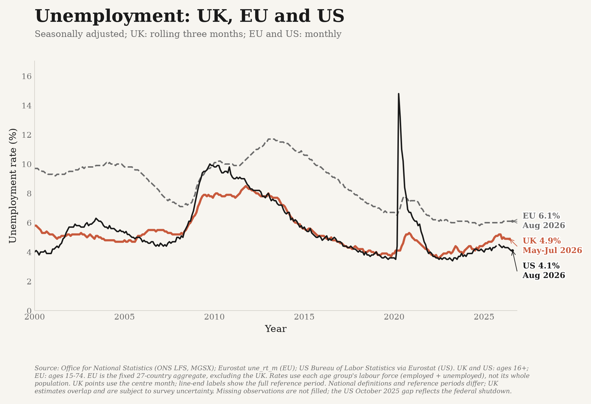
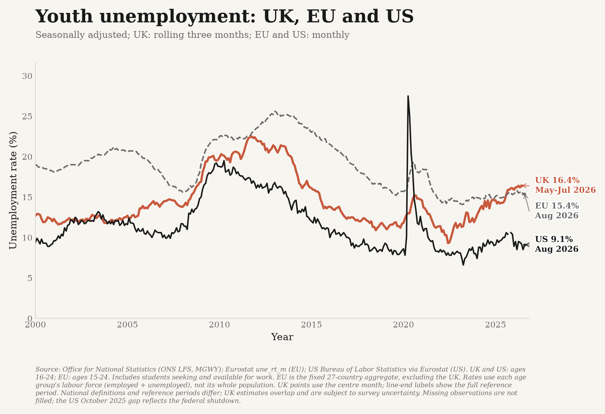

# Unemployment and youth unemployment

Separate overall and youth charts compare UK Labour Force Survey measures,
published by the Office for National Statistics (ONS), with EU and US references
from 2000 onward:





- **UK:** overall ages **16 and over**, ONS **MGSX**; youth ages **16-24**, ONS **MGWY**.
- **EU:** overall ages **15-74**; youth ages **15-24**. Eurostat's fixed
  **EU27_2020** aggregate excludes the UK throughout; it is not the euro area
  or an unweighted average of country unemployment rates.
- **US:** overall ages **16 and over**; youth ages **16-24**. Eurostat republishes
  these US Bureau of Labor Statistics figures without additional processing.

All rates divide unemployed people by the **economically active population
(employed plus unemployed)** within the stated age band. Neither is the proportion
of all people in that age group who are without work. The overall rate includes
young people; it is not a rate for those aged 25 and over.

Unemployed people are without a job and available to start work within two weeks,
and have either sought work in the previous four weeks or already obtained a job
that starts within the next two weeks. Economic inactivity is different: someone who is neither
employed nor unemployed is not in the rate's denominator.

Youth unemployment **includes full-time students** who meet that definition.
It is not the share of young people who are not in education, employment or
training. These UK youth figures start at age 16, so they must not be spliced with
international series covering ages 15-24.

## Reference periods and survey uncertainty

UK figures are seasonally adjusted **rolling three-month estimates**, not independent
monthly unemployment rates. ONS labels each observation with its **centre month**:
`2026 JUN` means **May-July 2026**, not June alone or June-August. The saved table
includes `period_start` and `period_end`, as well as that centre-month `date`.
Latest chart labels show the full period. Adjacent points have overlapping survey
windows and must not be treated as independent monthly samples.

EU and US references are seasonally adjusted **monthly** observations. The charts
retain these source frequencies rather than inventing matching three-month rates.
The x-axis aligns the UK centre month with the peers' calendar month; these are
contextual comparisons, not identically defined estimates. Latest labels give each
series' own actual period, and age bands appear in the source note and hover labels. The EU youth
series includes 15-year-olds, unlike the UK and US.

Recent Labour Force Survey estimates have additional uncertainty because of
response and collection problems. Collection and population-weighting changes
also affect comparisons through time. Youth estimates are particularly volatile;
small movements should not be overinterpreted. These charts use the current ONS
vintage throughout, without adding forecasts, smoothing observations, or
interpolating missing values. They do not add an invented confidence interval
when the source CSV does not provide one.

Both charts use the shared country colours: **UK orange, US black, EU grey**.
Direct line-end country/value/period labels replace the legend and repeated
latest-value banner. The full source history and actual-observation hover data
are retained; the EU also has a dashed line. Missing months break the line; they are not
interpolated. In particular, the US October 2025 household survey was not collected
during the federal shutdown, so neither US series has an observation that month.
Detailed documentation stays here rather than in a duplicated website methods section.

## Sources and reproducibility

- [ONS overall rate, MGSX](https://www.ons.gov.uk/employmentandlabourmarket/peoplenotinwork/unemployment/timeseries/mgsx/lms).
- [ONS youth rate, MGWY](https://www.ons.gov.uk/employmentandlabourmarket/peoplenotinwork/unemployment/timeseries/mgwy/lms).
- [ONS labour-market quality and methodology information](https://www.ons.gov.uk/employmentandlabourmarket/peopleinwork/employmentandemployeetypes/methodologies/labourforcesurveylfsqmi).
- [ONS September 2026 labour-market bulletin](https://www.ons.gov.uk/employmentandlabourmarket/peopleinwork/employmentandemployeetypes/bulletins/uklabourmarket/september2026).
- [Eurostat monthly unemployment, une_rt_m](https://ec.europa.eu/eurostat/databrowser/view/une_rt_m/default/table?lang=en).
- [Eurostat methods and national source details](https://ec.europa.eu/eurostat/cache/metadata/EN/une_rt_m_esms.htm).
- [BLS Current Population Survey definitions](https://www.bls.gov/cps/definitions.htm).

Both UK series are downloaded directly through the official ONS CSV generator,
dataset `LMS`. The tracked [source table](../data/unemployment_long.csv) records
the series, age group, seasonal adjustment, units and release date for each
observation. The [reference table](../data/unemployment_references.csv) records
Eurostat's `M.SA.TOTAL.PC_ACT.T` and `M.SA.Y_LT25.PC_ACT.T` series for `EU27_2020`
and `US`, including age bands, series identifiers, source URLs, source flags and
the dataset-update timestamp (not mislabelled as a national release date).
All six series are included in the scheduled full refresh.

```bash
./.venv/bin/python -m unemployment_data
./.venv/bin/python -m unemployment_data --from-csv data/unemployment_long.csv
```

Offline rebuilds also read `data/unemployment_references.csv`; use
`--references PATH` to select another saved reference table. Neither saved table is
replaced during offline reconstruction.

All sources must pass validation before either saved table is replaced: correct
series titles and identifiers, percentage units, UK coverage, age bands,
seasonal adjustment, finite rates between 0 and 100, unique dates, correctly
centred periods, the same publication vintage and latest period, full 2000-2025
coverage, and retention of every previously published observation. Live fetches
also reject releases more than 90 days old. Offline rebuilds do not enforce that
freshness limit.

The reference validator separately checks EU/US definitions, adjustment, units,
finite percentages, unique country/metric/month keys, complete 2000-2025 coverage
(except the documented US October 2025 absence), and retention of published
observations. Live reference downloads require a dataset updated within 90 days
and observations within 120 days. Source revisions remain allowed; lost history
or a failed peer download cannot silently publish a UK-only comparison.
